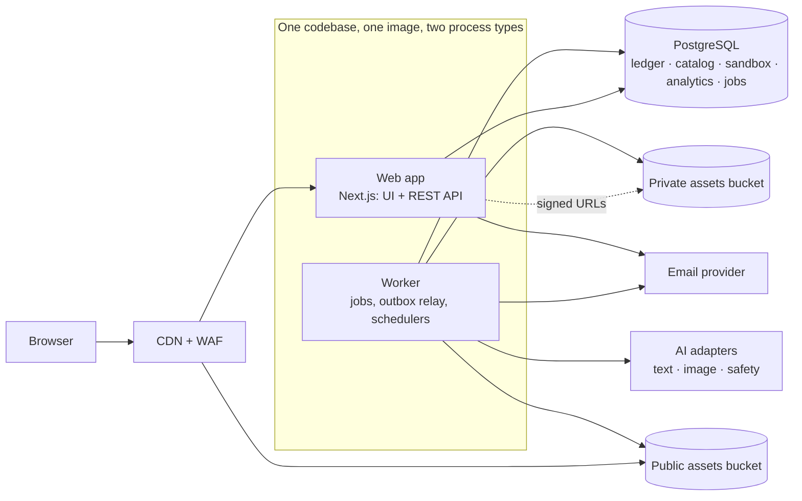

# DeluluMart — Architecture and Infrastructure Plan

Source: DeluluMart PRD v1.4 (19 Oct 2026, build baseline). Section references (§) point at the PRD.
Status: proposal for kickoff. Items marked **Decision** need an owner's sign-off (collected in §13).

---

## 1. What shapes the architecture

The PRD describes a small-traffic product with bank-grade correctness rules. Security is the first priority: where a choice trades security against speed of delivery, cost or convenience, security wins, and §8 is the part of this plan to review first. Six constraints drive almost every choice below:

| # | Constraint (PRD) | Architectural consequence |
|---|---|---|
| 0 | Security first: private wallets and histories, per-company isolation, untrusted AI output, staff powers over a ledger (§7.7, §7.15) | Defence in depth: every rule is enforced on the server and again in the database (grants, constraints, row-level security); least privilege per process; threat model in §8.1 drives the control list. |
| 1 | Ledger integrity is a release blocker: zero unexplained imbalance, no negative wallet, no double grant/debit (§4.2, §7.4) | One relational database; every money/stock/entitlement change is a single ACID transaction with a documented lock order, DB-level constraints, and idempotency keys. No distributed transactions, no eventual consistency on the write path. |
| 2 | NPC activity must be "separate by construction" (§7.6) | NPC data lives in its own schema with its own DB role that has no privileges on the ledger. Separation is enforced by Postgres grants and constraints, not by application discipline. |
| 3 | AI is slow, costs real money, and its output is untrusted (§7.7, §7.8) | AI runs only in background workers behind provider adapters, with a real-spend budget reservation, pinned versions, and no access to wallet/DB tools. Nothing AI-produced becomes public without passing the moderation state machine. |
| 4 | Load is tiny: 200-account beta, 20 checkouts/s and 100 browsing sessions as test loads (§7.11) | Start with one deployable and one database, but keep every seam that scaling needs (stateless web, queue behind an interface, read/write separation in code). §9.7 gives the scaling path and the trigger for each step. |
| 5 | Two engineers, 16–18 weeks (§8.1) | Managed infrastructure, infrastructure-as-code, as few moving parts as possible. |

The PRD's own proposal (§7.8) — modular monolith, TypeScript, PostgreSQL, object storage + CDN, background queue, provider adapters — is the right shape. This plan makes it concrete.

---

## 2. System overview



- **Web** handles every request synchronously, including checkout. It never calls an AI provider.
- **Worker** runs the same code with a different entrypoint: outbox relay, generation, moderation screening, image derivatives, share cards, rollups, reconciliation, expiry sweeps, exports, deletion.
- **PostgreSQL** is the only stateful service besides object storage. The job queue and the outbox live in it, so "commit the purchase and enqueue the follow-up" is one transaction.

---

## 3. Stack

| Concern | Choice | Why |
|---|---|---|
| Language | TypeScript end to end, Node.js LTS | PRD default; one language across UI, API, worker. |
| Web framework | Next.js (App Router), server-rendered public pages, REST route handlers under `/api` | Public catalog/product/store pages need SSR for share previews and the LCP ≤ 2.5 s target. The API follows the PRD's REST contract (§7.8) so idempotency, error codes and tests are uniform; the UI calls the same endpoints. |
| Domain code | Framework-free packages (`packages/core`) called by both web and worker | Lets ledger/checkout logic be tested against a real database without booting the web app. |
| Database | PostgreSQL 17, managed, Multi-AZ in production | Row locks, deferred constraint triggers, partial unique indexes, schemas/roles, full-text search — everything the PRD needs in one engine. |
| DB access | Kysely (typed SQL builder) + plain SQL migrations | The purchase path needs explicit `SELECT … FOR UPDATE` ordering and BIGINT handling; an ORM that hides locking is a liability here. BIGINT columns map to JS `bigint`; API money is decimal strings (§7.4). |
| Job queue | Graphile Worker (Postgres-backed) | Jobs can be enqueued inside the business transaction; no Redis to run, back up or reconcile. |
| Auth | Session-cookie auth with email magic link + Google OAuth, sessions stored in our Postgres (Better Auth or equivalent library) — **Decision D1** | See §8.1. |
| Object storage / CDN | S3 (one private, one public bucket) + CloudFront | §7.8. |
| Validation / contract | Zod schemas shared by API and UI, OpenAPI generated from them | Single source for request/response shapes and stable error codes. |
| UI | React, Tailwind with the PRD design tokens (§6.2), Radix primitives for accessible dialogs/menus | WCAG 2.2 AA target; focus trapping and announcements come from tested primitives. |
| Search | Postgres full-text (`tsvector`) + `pg_trgm` over approved product versions | Catalog is hundreds of rows in beta. |
| Rate limits / quotas | Postgres counters for per-account and per-company limits; WAF rate rules for coarse network limits | Company AI quotas are pooled and must be transactional anyway (§7.14). |
| Job status to browser | Polling `GET /generation-jobs/:id` | PRD explicitly allows it; keeps web stateless. |
| AI providers | Adapters for text drafting, image generation, text safety, image safety — vendors **Decision D3** | §7.8, §8.4 leave vendors open. |
| IaC / CI | OpenTofu (Terraform), GitHub Actions with OIDC to the cloud account | Reproducible environments; no long-lived deploy keys. |

Deliberately **not** in the beta: microservices, Redis, Kafka/SQS, Elasticsearch, Kubernetes, websockets, a separate analytics warehouse, a third-party product-analytics SDK.

---

## 4. Code layout and module boundaries

```
apps/
  web/        Next.js: (shop) public mart, /bank, /collection, /partner, /admin, /api/*
  worker/     Graphile Worker entrypoint + task registrations
packages/
  core/       domain modules (below); no HTTP, no framework imports
  db/         migrations, Kysely types, role grants, seed catalog (60 originals)
  contracts/  Zod schemas, error codes, event envelope definitions
  providers/  AI text/image/safety adapters, email, storage; fake implementations for tests
infra/        OpenTofu modules and per-environment stacks
tests/        e2e (Playwright), load (k6), safety-eval prompt set
```

Domain modules in `packages/core`, each exposing commands and queries only:

| Module | Owns | Notes |
|---|---|---|
| `identity` | users, sessions, verification, age attestation, privacy flags, deletion | |
| `ledger` | accounts, journals, postings, wallets, grants, reconciliation | The only module allowed to write money tables. |
| `bank` | virtual banks, bank accounts, cards, statements | Statement is a read projection of the ledger. |
| `pay` (DeluluPay) | checkout sessions, payment attempts, idempotency | Orchestrates; dispatches to purchase / company registration / warehouse purchase transactions. No second ledger (§7.8). |
| `catalog` | products, versions, search, saves, shelves, discovery ranking | |
| `orders` | player orders, ownership, receipts, reversals | |
| `inventory` | warehouses, inventory units, stock movements, exclusive editions | |
| `progression` | creator entitlement, passport, brand entitlement, collector levels | All evaluators are idempotent recomputations from authoritative records. |
| `company` | companies/stores, memberships, invitations, draft review workflow | |
| `studio` | drafts, generation jobs, assets, AI budget | |
| `moderation` | screening pipeline, cases, reports, appeals, blocks | |
| `npc` | NPC actors, simulation runs, sandbox orders | May not import `ledger`, `orders` or `inventory` write APIs — enforced by a lint rule **and** by DB grants. |
| `partner` | portal read models, rollups, exports | Read-only over other modules. |
| `analytics` | event intake, dedupe, metric definitions | |
| `admin` | staff commands, kill switches, audit log | |

A dependency-boundary lint (e.g. `dependency-cruiser`) runs in CI so the module graph cannot erode silently.

---

## 5. Data architecture

### 5.1 Schemas and database roles

| Schema | Contents | Write access |
|---|---|---|
| `core` | users, companies, products, versions, orders, ownership, inventory, entitlements, moderation, memberships | `app_web`, `app_worker` |
| `ledger` | ledger_account, journal, posting, wallet, grant | `app_web`, `app_worker` — **INSERT only** on journal/posting/grant; UPDATE only on wallet |
| `sandbox` | npc_actor, simulation_run, simulation_order, sandbox counters | `npc_worker` only |
| `analytics` | raw events (daily partitions), rollups, metric definitions | `app_worker` (events also `app_web`) |
| `audit` | admin/audit log, outbox | INSERT only for app roles |
| `graphile_worker` | job queue | library-managed |

Roles: `migrator` (owns objects, used only by the migration task), `app_web`, `app_worker`, `npc_worker` (no privileges on `ledger`, read-only on product snapshots), `reporting_ro` (read-only, for dashboards). "Append-only to application roles" (§7.9) is implemented as missing UPDATE/DELETE grants plus a trigger that raises on any attempt.

### 5.2 Ledger

- All amounts `BIGINT` paise. `ledger_account.type ∈ {USER, MINT, SINK}`; MINT may go negative, USER may not.
- A `journal` has an `event_type`, idempotency key, `config_version`, a funding-account reference, and links to its order / grant / reversal / registration / warehouse purchase. `posting` = (journal, account, signed amount).
- **Zero-sum**: a deferred constraint trigger on `posting` verifies `SUM(amount) = 0` per journal at commit.
- **Wallet** is a cached projection: `wallet.available_paise CHECK (>= 0)`, updated in the same transaction as the postings, with a `version` column. The daily reconciliation job recomputes it from postings and alerts on any difference; it never "fixes" the wallet (§7.12).
- **Uniqueness as constraints**: one STARTER grant per user; one RELIEF grant per (user, UTC day) plus a lifetime counter row locked on claim; one successful order per checkout session; one ownership per (buyer, product) including retired markers; one command result per (user, command type, idempotency key).
- **Multi-bank readiness** (§7.13): every order and journal carries the funding bank-account reference from day one, and threshold/relief evaluation goes through a single `total_owned_paise(user)` function. Enabling banks two and three later is a constraint migration, not a redesign.
- **Versioned configuration**: fees, price bounds, thresholds, quotas and level tables live in a `config_version` table; orders and entitlements snapshot the version applied.

### 5.3 Canonical lock order

Every command that touches money, stock, cards, seats or entitlements acquires row locks in this order and re-validates after locking. This is the "one documented lock order" §7.4 requires; the engineering lead signs it off (**Decision D2**).

1. `checkout_session`
2. `company` (company slot, publication cap, seat counter, warehouse count)
3. `warehouse` rows, ascending id
4. `product` (stock aggregate / current version)
5. `inventory_unit` (lowest available serial)
6. `virtual_card`
7. `wallet` rows, ascending ledger-account id (buyer and seller)
8. `creator_entitlement` / `brand_entitlement` / relief counter

Isolation is READ COMMITTED with explicit locks; correctness never depends on a cached read. Card freeze/replace takes only lock 6, so a freeze/pay race resolves to exactly one of "paid, then frozen" or "frozen, declined with no debit" (US-15). A last-unit race resolves at locks 4–5: one buyer gets the serial, the other gets `SOLD_OUT` before any wallet is touched (US-30).

### 5.4 Pay transaction (all three checkout types)

`POST /checkout-sessions/:id/pay` runs one database transaction:

1. Look up the idempotency record. Same key + same payload → return stored result. Same key + different payload → `CONFLICT`.
2. Check kill switches (read inside the transaction).
3. Acquire locks in canonical order; re-validate session state/expiry, quote and price version, publication status, block relationships, non-ownership, not-self/not-own-brand, stock, card status/owner/merchant scope, balance.
4. Write: payment attempt `SUCCEEDED`, order with immutable snapshots, journal + postings, ownership, inventory unit issue + stock movement, wallet updates, any threshold entitlement.
5. Insert outbox event(s) and store the idempotency result. Commit.

A validation failure writes a `FAILED` attempt with no journal and commits that instead. Notifications, analytics, collector levels, brand progression and rollups all happen after commit from the outbox and cannot affect whether the purchase succeeded (§7.4 step 4).

### 5.5 Outbox and consumers

`audit.outbox` rows are written in the business transaction; a trigger enqueues a relay job in the same commit. Each consumer records `(consumer, event_id)` under a unique constraint before applying its effect, so replays after a worker crash are harmless (§7.12 integration checks). Consumers: notifications, analytics event emission, collector-progress recompute, brand-progression recompute, partner rollup bucket rebuild, share-card invalidation.

### 5.6 NPC sandbox

- `sandbox.simulation_order` has `npc_actor_id NOT NULL`, no `buyer_user_id` column, and no foreign key to wallets, postings, orders, ownership or inventory. It stores a product **snapshot**, not a live reference that could consume stock.
- `core.player_order` has `CHECK (buyer_source IN ('PLAYER','STAFF'))` and `buyer_user_id NOT NULL`.
- The NPC scheduler runs under `npc_worker`, which cannot write outside `sandbox`. Enabling the feature flag therefore cannot contaminate the player economy even with a bug (§7.1).
- Reporting views always take a source argument; there is no view that unions the two.

### 5.7 Read models

| Projection | Built from | Freshness |
|---|---|---|
| Bank statement | ledger postings, in sequence | Transactional |
| Partner orders/finances | orders + journal links | ≤ 5 s (direct queries) |
| Partner daily rollups | committed orders and deduplicated events, per company/product/source/day in the company timezone | ≤ 5 min; bucket rebuilds on late events, reversals, exclusions |
| Brand progression | orders, buyer age, membership history, fraud exclusions | On event + 5-minute catch-up job |
| Collector progress | ownership + orders | On event; idempotent rebuild |
| Discovery ranking (Fresh / Player favorites) | approved versions, qualified saves | ≤ 5 min |

Rollups are disposable and rebuildable for anything order-derived. Funnel metrics (impressions, views) are the exception: raw events are kept only 90 days (§7.7), so the daily rollup is the durable record for those and must be backed up with the database.

---

## 6. Asynchronous work

| Queue / schedule | Work | Notes |
|---|---|---|
| `outbox-relay` | Fan out committed events to consumers | Triggered on insert + 1-minute sweep |
| `generation` | Screen input → reserve budget → call text/image provider → validate schema → screen output → store private asset | Bounded concurrency; 120 s timeout; late results cannot overwrite a newer draft revision (§7.8) |
| `screening` | Text and image safety checks for submissions and profile edits | Scanner outage leaves items pending, never approved (§7.7) |
| `assets` | Derivatives (AVIF/WebP at 320/640/1024, thumbnails ≤ 100 KB), promotion private → public on approval, removal + CDN invalidation on hide | |
| `share-cards` | Render product/store/receipt/milestone cards | Player totals only; NPC template watermarked |
| `npc` | Deterministic rules-based simulation runs | Runs as `npc_worker` |
| `exports` | Partner CSV, statement downloads, user data export | Formula-injection-safe cells; 24 h expiry; re-authorised at download |
| `deletion` | Unpublish, revoke sessions, retire balance to SINK, pseudonymise, purge assets, write tombstone | 30-day target |
| every 5 min | Brand-progression catch-up, ranking refresh, rollup refresh | |
| every minute | Expire checkout sessions, name reservations, invitations (release seats), resolve stuck `PENDING` attempts | |
| daily | Ledger reconciliation, inventory/edition invariant audit, retention purge, AI spend reconcile, analytics partition maintenance | Alerts on any mismatch |

---

## 7. AI, moderation and assets

### 7.1 Provider adapters

Four interfaces in `packages/providers`: `TextDrafter`, `ImageGenerator`, `TextSafety`, `ImageSafety`. Each job records provider, model, prompt-template and safety-policy versions (§7.8). Fakes with deterministic output back all automated tests; the template-illustration path is a first-class "provider" so the product works with AI paused.

Rules the adapters enforce:
- Input sent to a model is the concept text and category only — never email, IP, balances or profile data (§7.7).
- Output is parsed against a strict schema and treated as untrusted text; it is escaped on render and never executed or fetched.
- Price is never taken from model output.

### 7.2 Real-money budget

A `provider_budget` row per UTC day holds ceiling (₹5,000 default), reserved and actual spend. Enqueue reserves an estimate under a row lock; completion reconciles to actual; at ceiling new jobs return `BUDGET_PAUSED` while reserved jobs finish. Alert at 80%. This table is in real rupees and is kept out of every fictional-money view and dashboard (§7.10).

### 7.3 Moderation

One state machine for products (`DRAFT → SCREENING → PUBLISHED / NEEDS_REVIEW / REJECTED`, `PUBLISHED → HIDDEN / ARCHIVED`) with the brand workflow (`OWNER_REVIEW → OWNER_APPROVED → PLATFORM_SCREENING`) in front of it for worker-authored drafts. The same screening service handles handles, store names, descriptions, alt text and review notes. Staff queue, decisions, appeals and reporter-identity restriction live in `/admin`. A "publication paused" kill switch covers lapses in staff coverage.

### 7.4 Assets and share cards

- **Private bucket**: drafts, pending images, exports, statement downloads. Reached only through short-lived signed URLs issued after a permission check on every request (covers "removing a worker revokes private downloads immediately").
- **Public bucket** behind the CDN: approved image derivatives under content-addressed keys.
- **Hide/remove**: delete the public objects and invalidate the CDN paths; the product page returns the unavailable state.
- **Share cards** are served through an app route that re-checks publication status and returns a short-TTL response, rather than as permanent public objects, so they can be revoked (§7.7 "revalidated on request").

---

## 8. Security architecture

Principles: deny by default; enforce on the server and again in the database; least privilege for every process, role and person; no secret or private datum reaches the browser, a log or an AI provider unless it must; every privileged action is attributable and reversible only by an appended correction.

### 8.1 Threat model

| Threat | Example | Primary controls |
|---|---|---|
| Economic exploitation | Double grant, double spend, overdraw, replayed pay request, refund/rebuy farming, relief farming | Single-transaction writes, canonical lock order, unique constraints, idempotency records, non-negative wallet CHECK, daily reconciliation (§5) |
| Broken access control (IDOR) | Changing a company, order, card or export id in a URL; a worker calling finance endpoints | Central policy layer, server-resolved company scope, Postgres row-level security on tenant tables, authorisation matrix in CI (§8.3) |
| Account takeover | Stolen session, magic-link interception, OAuth account-linking abuse | Short-lived single-use links, session rotation, explicit linking only, re-authentication for sensitive actions, staff MFA (§8.2) |
| Insider or compromised staff account | Arbitrary reversal, minting compensation, reading private wallets | Separate admin surface, MFA, least-privilege staff roles, two-person approval for minting actions, tamper-evident audit log (§8.5) |
| Prompt injection and unsafe AI output | Concept text that instructs the model, output carrying markup or links | AI has no tools and no data access; schema validation; output escaped and screened; never auto-published (§7.1) |
| Injection and XSS | Stored script in a product name, formula injection in CSV | Parameterised SQL only, React escaping, strict CSP, inert CSV cells, no user HTML |
| SSRF and data exfiltration | Tricking the worker into fetching internal URLs | No user-supplied URL is ever fetched; worker egress restricted to an allowlist of provider hosts |
| Abuse and automation | Signup farms, scraping, generation spend exhaustion | WAF, bot challenge, per-account and per-company quotas, real-spend budget ceiling |
| Supply chain | Malicious dependency or build step | Lockfile-only installs, dependency and image scanning, pinned actions, signed images (§8.6) |
| Data exposure | Leaked backup, public bucket, verbose logs | Encryption at rest and in transit, private-by-default buckets, log redaction, separate accounts per environment |
| Privacy failure | Deleted user restored from backup, reporter identity leaked to a creator | Deletion tombstones reapplied on restore, restricted reporter fields, pseudonymised ledger references |

### 8.2 Authentication — Decision D1

Controls regardless of provider: magic links are single-use, expire in 15 minutes and are bound to the requesting browser; session ids rotate at sign-in and privilege change; cookies are Secure, HTTP-only, SameSite=Lax with the `__Host-` prefix; idle and absolute session timeouts; re-authentication before card replacement, data export, account deletion and company registration; all sessions revoked on suspension or deletion; staff accounts require phishing-resistant MFA (passkeys) and cannot use magic links alone.

Functional requirements: magic link + OAuth; unverified accounts can do nothing economic; duplicate provider identities resolve through explicit linking, never automatically; immediate session revocation on deletion/suspension; staff MFA; provisioning must be idempotent under concurrent callbacks.

Recommendation: a well-maintained auth library with sessions and identities in our own Postgres, rather than a hosted identity service. Reasons: revocation and "one grant per verified identity" become ordinary rows and constraints in the same database as the ledger; no user PII leaves the primary region; no per-user vendor cost. The PRD says "managed authentication" (§7.8), so this is a deviation to approve. If the team prefers hosted, the `identity` module hides the choice behind `auth_subject`, and the rest of this plan is unchanged.

Provisioning (`POST /account/provision`) is one transaction keyed on `auth_subject`: user row, bank account, ledger account, wallet, starter grant journal, card. Unique constraints make a concurrent second callback return the existing records (US-01, US-14).

### 8.3 Authorisation

A single policy layer in `core` is called by every command and query — web routes, worker jobs and generation callbacks alike (§7.14). Inputs: actor, verified/suspended state, company tier, membership role, draft assignment, resource owner. Rules of thumb:

- Every partner query is scoped by `company_id` resolved from the actor's memberships on the server, never from a URL or filter alone; cache keys and export jobs include it.
- Workers have no route to orders, finances, analytics or bank data; these are separate endpoints that require the owner role, not hidden UI.
- Staff is a separate role set with MFA, least-privilege permissions and its own route group; a portal account is never a staff role.
- CI runs an authorisation matrix test: owner, stranger, worker, removed worker, suspended user and moderator against every private endpoint (§7.8). A new route without a matrix entry fails the build.
- **Database backstop**: Postgres row-level security on company-scoped and owner-scoped tables (orders, drafts, finances, exports, bank accounts, cards, statements). Each request sets the actor and company for its transaction; a query that forgets its `WHERE` clause returns nothing instead of another tenant's data.
- Public identifiers are random and unguessable; sequential ids never appear in URLs.

### 8.4 Application, data and network controls

**Application**
- CSRF tokens plus origin checks on every state-changing request; strict Content-Security-Policy with nonces, no inline script; `frame-ancestors 'none'`; HSTS; restrictive MIME types and `nosniff` on asset responses.
- All input validated against shared schemas at the edge of the API; all SQL parameterised; error responses use stable codes and never echo internals or card tokens.
- Card, invitation and magic-link tokens are stored only as hashes and compared in constant time.
- Bot challenge on signup, generation and reports; WAF managed rules and rate rules by coarse network; per-account limits from §7.5 in Postgres.

**Process isolation (least privilege)**
- Web, worker, NPC worker and migration task each have their own cloud role and database role. Web holds no AI provider keys; the worker holds no session-signing keys; the NPC role cannot touch the ledger; only the migration task can alter schema.
- No process uses a database superuser or object-owner role at runtime.

**Data protection**
- TLS everywhere, including app-to-database; encryption at rest with managed keys for database, backups and buckets.
- Data minimisation as specified in §7.7: no real name, address, payment or location data is collected at all, which removes the most damaging breach classes outright.
- Secrets live only in the secret manager, are distinct per environment and are rotated on a schedule and on any staff departure.
- Retention jobs enforce the §7.7 schedule; logs and analytics are redacted at source (no email, raw prompt, token or full IP).

**Network**
- Database and tasks in private subnets with no public addresses; security groups allow only load balancer → web and web/worker → database.
- The origin accepts traffic only from the CDN, so the WAF cannot be bypassed.
- Outbound traffic from the worker is restricted to an allowlist of provider hostnames; web has no general outbound access.
- Buckets block all public access; the public bucket is readable only through the CDN.

Risk signals for linked-account review are limited to session/device identifiers and truncated, hashed network prefixes, kept 30 days. What may be collected needs the privacy reviewer's approval before the first invite (**Decision D5**).

### 8.5 Staff access, kill switches and audit

- The admin surface is served on a separate hostname with its own session cookie, shorter timeouts and passkey MFA; it is not reachable with a player session.
- Staff roles are granular (moderator, support, economy, admin). Moderators cannot issue reversals; support cannot change entitlements.
- Any action that mints currency (compensation) or revokes an entitlement requires a second staff member's approval before it executes.
- Staff can see provenance and source before acting (§7.12) but have no screen that edits a balance; the only money tool is a compensating journal.
- `system_switch` rows for purchases, signup grants, generation, NPC and publication (§7.12) are read inside the relevant transactions and toggled from the admin surface.
- Every staff action writes an append-only audit row with actor, reason, target and a hash of the previous row, so deletion or alteration of history is detectable. Audit rows are also shipped to a write-once bucket in a separate account.
- Engineers have no standing production database access; break-glass access is time-limited, logged and reviewed.

### 8.6 Secure delivery and assurance

- Branch protection with required review; secret scanning, dependency audit, static analysis and container image scanning on every pull request; third-party CI actions pinned by commit hash; images signed and deployed by digest.
- Deployment uses short-lived federated credentials; there are no long-lived cloud keys in CI or on laptops.
- Cloud audit trail, threat detection and configuration-compliance checks enabled in both accounts, with alerts routed to the on-call channel.
- Security gates on the roadmap: threat-model review at the end of week 1; authorisation and ledger abuse-case tests from week 2; internal security review before the first invite; independent penetration test before public expansion (§8.2 of the PRD requires a permission/security review there).
- Published security contact and a written incident-response runbook: contain with kill switches, preserve evidence, reconcile, notify per the privacy reviewer's guidance.

---

## 9. Infrastructure

### 9.1 Hosting — Decision D4

Recommendation: **AWS, Mumbai (ap-south-1)**. The initial cohort is India-based, so latency and data-residency questions are simplest in-region, and RDS gives point-in-time recovery that meets the recovery objectives without custom work.

| Component | Service | Beta sizing (production) |
|---|---|---|
| Edge | CloudFront + AWS WAF, ACM certificates, Route 53 | One distribution: app origin + public-assets origin |
| Web | ECS Fargate service behind an ALB | 2 tasks × 0.5 vCPU / 1 GB, across two AZs |
| Worker | ECS Fargate service | 1 task × 0.5 vCPU / 1 GB (2 when generation is enabled) |
| Migrations | One-off Fargate task run by the deploy pipeline | Uses the `migrator` role |
| Database | RDS PostgreSQL, Multi-AZ, encrypted, PITR, 30-day backup retention | db.t4g.small–medium, 50 GB gp3 |
| Storage | S3 private + S3 public (CloudFront origin access only), versioning on, lifecycle rules for exports and raw prompts | |
| Email | SES (magic links only) | |
| Secrets / config | Secrets Manager, SSM Parameter Store | |
| Network | VPC, private subnets for tasks and DB, one NAT gateway for provider egress | |
| Observability | CloudWatch logs/metrics/alarms, Sentry for errors, OpenTelemetry traces | Alarms to an on-call channel |
| Internal dashboards | Metabase (or Grafana) on the `reporting_ro` role | Economy, funnel, moderation, AI cost |

This comfortably covers the stated test loads; the first scaling step, if ever needed, is a larger DB instance and more web tasks, with no design change.

Rough running cost: on the order of US$200–300/month for production and about US$100 for staging, before AI spend. AI spend is separately capped at ₹5,000/day by the application. These are estimates to check against current pricing.

A lighter alternative (a container PaaS plus hosted Postgres with PITR) would run the same container images and cost less. The application has no AWS-specific code outside `packages/providers`, so this is reversible.

### 9.2 Environments

| Env | Where | Data | Purpose |
|---|---|---|---|
| Local | Docker Compose: Postgres, S3-compatible store, mail catcher, fake AI providers | Seed catalog + fixtures | Development and CI integration tests |
| Staging | Separate non-production AWS account, single-AZ, smaller instances | Synthetic only; never a copy of production PII | Release candidate, load tests, restore drills, staff QA of inventory (§7.16) |
| Production | Production AWS account | Real beta data | |

Separate accounts give the "separate secrets and datasets" the PRD asks for (§7.8) by default rather than by convention.

### 9.3 Delivery pipeline

1. Pull request: typecheck, lint (including module boundaries), unit and property tests, integration tests against a Postgres container, accessibility scan, bundle-size budget (≤ 250 KB gzipped initial route JS).
2. Merge to main: build one image, push to the registry, deploy to staging: run migrations task → roll web and worker → smoke tests (provision, purchase, reconcile).
3. Production: manual approval, same image, same sequence.

Migrations follow expand/contract so the previous image keeps working during and after a deploy; rollback is "redeploy the previous image". Ledger tables only ever gain columns.

### 9.4 Backup, recovery and incidents

- Objectives (§7.8): ≤ 15 min data loss, ≤ 4 h restore. RDS PITR typically restores to within about five minutes; Multi-AZ covers instance failure.
- Recovery runbook: enable the purchases and grants kill switches → restore → reapply deletion tombstones (kept in a small table that is also exported to S3, so a restore cannot resurrect deleted users) → run reconciliation → re-enable.
- A staging restore-and-reconcile drill is an exit gate before public expansion (§8.2).
- Integrity incidents put the site in browse-only mode: cached public pages stay up, purchases and new grants are off (§7.11).

### 9.5 Observability and alerts

| Signal | Alert |
|---|---|
| Daily ledger reconciliation (journals sum to zero, wallet = Σ postings, supply identity of §7.4) | Any mismatch pages; affected writes are frozen |
| Inventory audit (edition invariant, warehouse usage within capacity, no duplicate serials) | Any violation |
| Checkout technical success rate | < 99.5% over the window |
| Purchase p95 / catalog p95 | > 800 ms / > 500 ms |
| Outbox lag, job queue depth, stuck `PENDING` attempts | Thresholds |
| AI spend | 80% and 100% of the daily ceiling |
| Moderation queue age | Beyond staffed targets → consider pausing publication |
| Unlabelled NPC rows / any NPC write outside `sandbox` | Should be impossible; alert on permission-denied errors from `npc_worker` |

Logs are structured and carry no email, raw prompt, token or full IP (§7.10).

### 9.6 Analytics pipeline

First-party only. The browser batches events to `POST /api/events`; the server validates the envelope, pseudonymises, deduplicates on `event_id` and inserts into day-partitioned tables dropped after 90 days. Server-authoritative events (purchase, unlock, grant) come from the outbox, never from the client. Metric definitions are versioned rows so a dashboard number can always be traced to a definition and an as-of time (§7.15).

### 9.7 Scaling path

The beta design is sized for hundreds of users, but nothing in it has to be rewritten to grow. Each step below is taken only when its trigger is observed; the order reflects where this system will actually feel pressure first.

| Step | Trigger | Change | Design seam that makes it cheap |
|---|---|---|---|
| 1. Scale web horizontally | CPU or latency on web tasks | Autoscale tasks behind the load balancer | Web is stateless; sessions and limits live in Postgres |
| 2. Cache public reads harder | Catalog and product page traffic dominates | CDN caching of public pages with tag-based invalidation on publish/hide | Public pages never contain wallet or viewer-specific data; those load separately |
| 3. Connection pooling | Connection count nears the database limit | Managed pooler in transaction mode | All transactions are short and never span requests |
| 4. Read replica | Partner portal, analytics and search load compete with checkout | Route portal/reporting/search queries to a replica | Queries and commands are already separate functions; wallet, entitlement and buy-eligibility reads stay on the primary (§7.8) |
| 5. Partition large tables | Postings, orders, outbox or events pass tens of millions of rows | Time-based partitioning; archive old partitions | Append-only tables with time-ordered keys |
| 6. Dedicated rate-limit store and queue | Quota counters or job volume become a visible share of database load | Redis for counters; a managed queue for generation and assets | Limits and queue sit behind interfaces; the outbox stays in Postgres as the source of truth |
| 7. Hot-row relief | One popular seller or one exclusive drop serialises checkouts | Seller credits accumulated through an append-only pending-credit table settled in batches; per-product purchase queue for drops | Seller proceeds already go through one ledger function; system accounts (MINT, SINK) carry no cached balance row, so they are never a lock hotspot |
| 8. Search and analytics services | Catalog passes roughly 100k listings; reporting needs outgrow Postgres | Dedicated search index fed from the outbox; event stream to a warehouse | Outbox events are versioned and already carry what both need |
| 9. Vertical then functional database split | Primary is saturated after steps 2–7 | Larger instance first; then move analytics and sandbox schemas to their own databases | Schemas have no cross-schema foreign keys into `ledger` except from `core` |

Two things stay fixed at any scale: the money path remains a single-database ACID transaction (sharding the ledger is the last resort, and far beyond any plausible size for this product), and correctness never depends on a cache.

Load tests in staging should be rerun at 10× the PRD targets before public expansion to confirm where the first limit actually is, rather than assuming.

---

## 10. Verification strategy

| Layer | Tooling | Covers |
|---|---|---|
| Unit / property | Vitest + fast-check | Fee rounding, paise boundaries (threshold at 1,000,000,000 paise), zero-sum journals, relief limits, level thresholds |
| Integration (real Postgres) | Vitest + Testcontainers, tests that launch truly concurrent transactions | Simultaneous sign-in callbacks, competing purchases on insufficient funds, last-unit race, freeze vs pay, price edit vs buy, hide vs buy, final worker seat, final warehouse, reversal after seller spent funds, outbox replay |
| Isolation | Tests that add and delete NPC data and assert wallets, rankings, qualified counts and north-star metrics are byte-identical | US-10 across every surface in §7.6 |
| Authorisation matrix | Generated from the route table | US-23, US-32 |
| End to end | Playwright + axe; manual keyboard/screen-reader passes | Journeys J1–J7, no-AI fallback, deletion and share-card purge |
| Load | k6 against staging | 20 checkouts/s, 100 browsing sessions |
| Safety evaluation | Versioned set of ≥ 100 safe/unsafe prompts run through the real pipeline | Gate before enabling generation (§7.12) |

Concurrency tests are the highest-value tests in the project and are written alongside the ledger in weeks 2–4, not after.

---

## 11. Build sequence

Mapped to the PRD roadmap (§8.1); infrastructure items in bold.

| Weeks | Application | Infrastructure |
|---|---|---|
| 1 | Prototype; confirm decisions D1–D6; threat-model review | **Repo scaffold, CI, local Compose stack, cloud accounts, IaC skeleton** |
| 2–4 | Identity, provisioning, ledger, bank/card, DeluluPay, seed catalog, purchase, collection, receipts | **Staging environment, DB roles/grants, migrations pipeline, reconciliation job + alert, kill switches, Sentry/logging** |
| 5–6 | Unlock paths, company registration + sponsorship, studio, generation, moderation, reports/appeals | **Worker service, private/public buckets + CDN, provider adapters and budget, safety-eval harness, WAF + bot challenge** |
| 7–10 | Partner Portal, rollups, exports, share cards, `/admin` | **Analytics intake and partitions, internal dashboards, production environment, backup + first restore drill** |
| 11–12 | Solo-company smoke beta (50 users) | **On-call alerts tuned, runbooks, load test** |
| 13–14 | Brand tier, invitations, worker workflow | Authorisation matrix extended to worker roles |
| 15–16 | Warehouses, stock, exclusives, collector levels | **Inventory audit job and alerts** |
| 17–18 | Observation and expansion decision | Restore-and-reconcile drill, security review, AI unit-cost review |

One sequencing change from the PRD worth considering: the `inventory_unit` lock and `inventory_mode` column should exist in the purchase transaction from week 2 (with every product initially `UNLIMITED_SEED`), so that weeks 15–16 add behaviour rather than rewriting the most safety-critical code path after two beta cohorts have used it.

---

## 12. Gaps noticed in the PRD

These do not block starting, but each needs an answer before the phase that depends on it.

1. **Invite mechanism is unspecified.** "Invite beta" needs an allowlist or invite codes, and a rule for who can issue them. Proposed: staff-issued single-use codes checked at verification.
2. **Age attestation flow** — the field exists (`age_attested_at`) but the screen and wording are not specified; needs the legal reviewer.
3. **How STAFF accounts are marked** and whether staff may hold normal player wallets in production (affects `buyer_source` and every exclusion filter).
4. **Risk signals** — which device/network signals may be collected and retained (Decision D5).
5. **Funnel metrics vs 90-day raw retention** — rollups become the only record; confirm that is acceptable (§5.7).
6. **Reporting timezone vs UTC day** — partner reports bucket in Asia/Kolkata while relief and quotas reset in UTC; the UI must state both, as §7.11 hints.
7. **Staff coverage tooling** — "pause publication when coverage lapses" needs a named owner and a manual switch at minimum.

---

## 13. Decisions needed at kickoff

| ID | Decision | Recommendation | Owner (PRD role) |
|---|---|---|---|
| D1 | Auth: in-database library vs hosted identity service | Library with sessions in Postgres, subject to the controls in §8.2 | Engineering, privacy |
| D2 | Canonical lock order (§5.3) | As listed | Engineering lead |
| D3 | AI vendors: text, image, text safety, image safety | Choose on measured cost per approved listing (target ≤ ₹50) and safety-eval results; image cost will dominate | Engineering, safety |
| D4 | Hosting | AWS Mumbai, two accounts | Engineering |
| D5 | Risk-signal collection and retention | Hashed truncated network prefix + session/device id, 30 days | Privacy / legal |
| D6 | Introduce inventory columns in the week-2 purchase transaction | Yes | Engineering, product |
