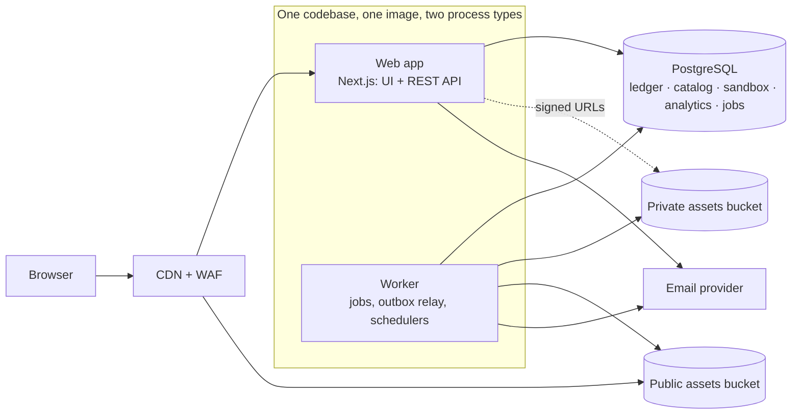

# DeluluMart — Architecture and Infrastructure Plan

Source: DeluluMart PRD v1.4 (19 Oct 2026, build baseline) plus Revision 1.5 (`docs/prd-v1.5-revision.md`), which adds cart, payment methods, simulated delivery, coupons, the Commerce Console and portal additions. Section references (§) point at the PRD; "R" references point at Revision 1.5. The architecture for the 1.5 modules is in §15, and the approach to building with AI coding agents is in §16.
Scope change from the PRD: **V1 ships without AI-assisted creation ("Build with AI").** Creators write their own listing text and choose a template illustration. The PRD lists AI text/image as P0 (§7.1), so this needs a PRD revision; this plan already reflects it (§7).
Status: proposal for kickoff. Items marked **Decision** need an owner's sign-off (collected in §13).

---

## 1. What shapes the architecture

The PRD describes a small-traffic product with bank-grade correctness rules. Security is the first priority: where a choice trades security against speed of delivery, cost or convenience, security wins, and §8 is the part of this plan to review first. Six constraints drive almost every choice below:

| # | Constraint (PRD) | Architectural consequence |
|---|---|---|
| 0 | Security first: private wallets and histories, per-company isolation, untrusted user-written content, staff powers over a ledger (§7.7, §7.15) | Defence in depth: every rule is enforced on the server and again in the database (grants, constraints, row-level security); least privilege per process; threat model in §8.1 drives the control list. |
| 1 | Ledger integrity is a release blocker: zero unexplained imbalance, no negative wallet, no double grant/debit (§4.2, §7.4) | One relational database; every money/stock/entitlement change is a single ACID transaction with a documented lock order, DB-level constraints, and idempotency keys. No distributed transactions, no eventual consistency on the write path. |
| 2 | NPC activity must be "separate by construction" (§7.6) | NPC data lives in its own schema with its own DB role that has no privileges on the ledger. Separation is enforced by Postgres grants and constraints, not by application discipline. |
| 3 | V1 has no AI generation; all public content is user-written text plus template art and must be moderated before it is public (§7.7) | No AI provider, no real-money spend and no long-running jobs in V1. Every text field passes the moderation state machine. The draft model keeps a seam (`image_source`, a provider interface) so generation can be added later without schema rework. |
| 4 | Load is tiny: 200-account beta, 20 checkouts/s and 100 browsing sessions as test loads (§7.11) | Start with one deployable and one database, but keep every seam that scaling needs (stateless web, queue behind an interface, read/write separation in code). §9.7 gives the scaling path and the trigger for each step. |
| 5 | Two engineers, 16–18 weeks (§8.1) | Managed infrastructure, infrastructure-as-code, as few moving parts as possible. |

The PRD's own proposal (§7.8) — modular monolith, TypeScript, PostgreSQL, object storage + CDN, background queue — is the right shape. This plan makes it concrete.

---

## 2. System overview



- **Web** handles every request synchronously, including checkout. 
- **Worker** runs the same code with a different entrypoint: outbox relay, moderation screening, share cards, rollups, reconciliation, expiry sweeps, exports, deletion.
- **PostgreSQL** is the only stateful service besides object storage. The job queue and the outbox live in it, so "commit the purchase and enqueue the follow-up" is one transaction.

---

## 3. Stack

| Concern | Choice | Why |
|---|---|---|
| Language | TypeScript end to end, Node.js LTS | PRD default; one language across UI, API, worker. |
| Web framework | Next.js (App Router), server-rendered public pages, REST route handlers under `/api` | Public catalog/product/store pages need SSR for share previews and the LCP ≤ 2.5 s target. The API follows the PRD's REST contract (§7.8) so idempotency, error codes and tests are uniform; the UI calls the same endpoints. |
| Domain code | Framework-free packages (`packages/core`) called by both web and worker | Lets ledger/checkout logic be tested against a real database without booting the web app. |
| Database | PostgreSQL 17, managed, Multi-AZ in production | Row locks, deferred constraint triggers, partial unique indexes, schemas/roles, full-text search — everything the PRD needs in one engine. |
| DB access | Drizzle ORM: schema defined in TypeScript, generated migrations, plus hand-written SQL migrations for roles, grants, policies and triggers | The schema is one typed file set that both people and coding agents read; it supports explicit `FOR UPDATE` locking and raw SQL where the purchase path needs it. BIGINT columns map to JS `bigint`; API money is decimal strings (§7.4). |
| Job queue | Graphile Worker (Postgres-backed) | Jobs can be enqueued inside the business transaction; no Redis to run, back up or reconcile. |
| Auth | Managed auth bundled with the database: email magic link + Google OAuth, TOTP MFA for staff — **Decision D1** | See §8.2 of this plan. |
| Object storage / CDN | One private and one public bucket behind a CDN, through a storage adapter (free tier first, S3 + CloudFront later) | §7.8. |
| Validation / contract | Zod schemas shared by API and UI, typed API client and OpenAPI generated from them | Single source for request/response shapes and stable error codes; a contract change that breaks a caller fails the type check. |
| UI | React, Tailwind with the PRD design tokens (§6.2), shadcn/ui components (built on Radix primitives) copied into the repo | WCAG 2.2 AA target; accessible primitives; the component source lives in the codebase, which is what coding agents work with best (§16). |
| Caching | CDN page cache with tag-based invalidation for public pages; in-memory browser cache for private data; nothing private in any shared cache | Fast public browsing at no cost; see §5.8. |
| Search | Postgres full-text (`tsvector`) + `pg_trgm` over approved product versions | Catalog is hundreds of rows in beta. |
| Rate limits / quotas | Postgres counters for per-account and per-company limits; WAF rate rules for coarse network limits | Publication and draft caps are pooled per company and must be transactional anyway (§7.14). |
| AI generation | Not in V1. Manual text and a template illustration library only | Scope decision; the PRD's no-AI fallback path (§7.8) becomes the only path. |
| Hosting | Free tiers for the build and beta; AWS Mumbai as the paid target | Self-funded project; see §9.1. |
| IaC / CI | GitHub Actions; database roles, grants and policies as migrations; OpenTofu when on the paid profile | Reproducible environments; no long-lived deploy keys. |

Deliberately **not** in the beta: microservices, Redis, Kafka/SQS, Elasticsearch, Kubernetes, websockets, a separate analytics warehouse, a third-party product-analytics SDK.

---

## 4. Code layout and module boundaries

```
apps/
  web/        Next.js: (shop) public mart, /bank, /collection, /partner, /admin, /api/*
  worker/     Graphile Worker entrypoint + task registrations
packages/
  core/       domain modules (below); no HTTP, no framework imports
  db/         migrations, Kysely types, role grants, seed catalog (60 originals)
  contracts/  Zod schemas, error codes, event envelope definitions
  providers/  email, storage, text-screening adapter; fake implementations for tests
infra/        OpenTofu modules and per-environment stacks
tests/        e2e (Playwright), load (k6), moderation-eval text set
```

Domain modules in `packages/core`, each exposing commands and queries only:

| Module | Owns | Notes |
|---|---|---|
| `identity` | users, sessions, verification, age attestation, privacy flags, deletion | |
| `ledger` | accounts, journals, postings, wallets, grants, reconciliation | The only module allowed to write money tables. |
| `bank` | virtual banks, bank accounts, cards, statements | Statement is a read projection of the ledger. |
| `pay` (DeluluPay) | checkout sessions, payment attempts, idempotency | Orchestrates; dispatches to purchase / company registration / warehouse purchase transactions. No second ledger (§7.8). |
| `catalog` | products, versions, search, saves, shelves, discovery ranking | |
| `orders` | player orders, ownership, receipts, reversals | |
| `inventory` | warehouses, inventory units, stock movements, exclusive editions | |
| `progression` | creator entitlement, passport, brand entitlement, collector levels | All evaluators are idempotent recomputations from authoritative records. |
| `company` | companies/stores, memberships, invitations, draft review workflow | |
| `studio` | drafts, revisions, template illustration selection | No generation in V1. |
| `moderation` | screening pipeline, cases, reports, appeals, blocks | |
| `npc` | NPC actors, simulation runs, sandbox orders | May not import `ledger`, `orders` or `inventory` write APIs — enforced by a lint rule **and** by DB grants. |
| `partner` | portal read models, rollups, exports | Read-only over other modules. |
| `cart` | carts, lines, delivery options and totals preview | No price or stock authority (R2.2). |
| `fulfilment` | delivery spots, speeds, shipments, timelines, Zap hub eligibility | R5. |
| `promotions` | coupons, redemptions, campaigns and budgets, sale and reference prices | R6. |
| `membership` | Delulu Plus periods and benefits | R5.5. |
| `console` | back-office configuration for catalog, merchandising, shipping, payments, promotions, economy | R7; every write is versioned and audited. |
| `analytics` | event intake, dedupe, metric definitions | |
| `admin` | staff commands, kill switches, audit log | |

A dependency-boundary lint (e.g. `dependency-cruiser`) runs in CI so the module graph cannot erode silently.

---

## 5. Data architecture

### 5.1 Schemas and database roles

| Schema | Contents | Write access |
|---|---|---|
| `core` | users, companies, products, versions, orders, ownership, inventory, entitlements, moderation, memberships | `app_web`, `app_worker` |
| `ledger` | ledger_account, journal, posting, wallet, grant | `app_web`, `app_worker` — **INSERT only** on journal/posting/grant; UPDATE only on wallet |
| `sandbox` | npc_actor, simulation_run, simulation_order, sandbox counters | `npc_worker` only |
| `analytics` | raw events (daily partitions), rollups, metric definitions | `app_worker` (events also `app_web`) |
| `audit` | admin/audit log, outbox | INSERT only for app roles |
| `graphile_worker` | job queue | library-managed |

Roles: `migrator` (owns objects, used only by the migration task), `app_web`, `app_worker`, `npc_worker` (no privileges on `ledger`, read-only on product snapshots), `reporting_ro` (read-only, for dashboards). "Append-only to application roles" (§7.9) is implemented as missing UPDATE/DELETE grants plus a trigger that raises on any attempt.

### 5.2 Ledger

- All amounts `BIGINT` paise. `ledger_account.type ∈ {USER, MINT, SINK}`; MINT may go negative, USER may not.
- A `journal` has an `event_type`, idempotency key, `config_version`, a funding-account reference, and links to its order / grant / reversal / registration / warehouse purchase. `posting` = (journal, account, signed amount).
- **Zero-sum**: a deferred constraint trigger on `posting` verifies `SUM(amount) = 0` per journal at commit.
- **Wallet** is a cached projection: `wallet.available_paise CHECK (>= 0)`, updated in the same transaction as the postings, with a `version` column. The daily reconciliation job recomputes it from postings and alerts on any difference; it never "fixes" the wallet (§7.12).
- **Uniqueness as constraints**: one STARTER grant per user; one RELIEF grant per (user, UTC day) plus a lifetime counter row locked on claim; one successful order per checkout session; one ownership per (buyer, product) including retired markers; one command result per (user, command type, idempotency key).
- **Multi-bank readiness** (§7.13): every order and journal carries the funding bank-account reference from day one, and threshold/relief evaluation goes through a single `total_owned_paise(user)` function. Enabling banks two and three later is a constraint migration, not a redesign.
- **Versioned configuration**: fees, price bounds, thresholds, quotas and level tables live in a `config_version` table; orders and entitlements snapshot the version applied.

### 5.3 Canonical lock order

Every command that touches money, stock, cards, seats or entitlements acquires row locks in this order and re-validates after locking. This is the "one documented lock order" §7.4 requires; the engineering lead signs it off (**Decision D2**).

1. `checkout_session`
1a. `coupon` and `promo_campaign` (redemption cap and budget), `membership` row of the buyer
2. `company` (company slot, publication cap, seat counter, warehouse count)
3. `warehouse` rows, ascending id
4. `product` (stock aggregate / current version)
5. `inventory_unit` (lowest available serial)
6. `virtual_card`
7. `wallet` rows, ascending ledger-account id (buyer and every seller in the order group)
8. `creator_entitlement` / `brand_entitlement` / relief counter

Isolation is READ COMMITTED with explicit locks; correctness never depends on a cached read. Card freeze/replace takes only lock 6, so a freeze/pay race resolves to exactly one of "paid, then frozen" or "frozen, declined with no debit" (US-15). A last-unit race resolves at locks 4–5: one buyer gets the serial, the other gets `SOLD_OUT` before any wallet is touched (US-30).

### 5.4 Pay transaction (all three checkout types)

`POST /checkout-sessions/:id/pay` runs one database transaction:

1. Look up the idempotency record. Same key + same payload → return stored result. Same key + different payload → `CONFLICT`.
2. Check kill switches (read inside the transaction).
3. Acquire locks in canonical order; re-validate session state/expiry, quote and price version, publication status, block relationships, non-ownership, not-self/not-own-brand, stock, card status/owner/merchant scope, balance.
4. Write: payment attempt `SUCCEEDED`, order with immutable snapshots, journal + postings, ownership, inventory unit issue + stock movement, wallet updates, any threshold entitlement.
5. Insert outbox event(s) and store the idempotency result. Commit.

A validation failure writes a `FAILED` attempt with no journal and commits that instead. Notifications, analytics, collector levels, brand progression and rollups all happen after commit from the outbox and cannot affect whether the purchase succeeded (§7.4 step 4).

### 5.5 Outbox and consumers

`audit.outbox` rows are written in the business transaction; a trigger enqueues a relay job in the same commit. Each consumer records `(consumer, event_id)` under a unique constraint before applying its effect, so replays after a worker crash are harmless (§7.12 integration checks). Consumers: notifications, analytics event emission, collector-progress recompute, brand-progression recompute, partner rollup bucket rebuild, share-card invalidation.

### 5.6 NPC sandbox

- `sandbox.simulation_order` has `npc_actor_id NOT NULL`, no `buyer_user_id` column, and no foreign key to wallets, postings, orders, ownership or inventory. It stores a product **snapshot**, not a live reference that could consume stock.
- `core.player_order` has `CHECK (buyer_source IN ('PLAYER','STAFF'))` and `buyer_user_id NOT NULL`.
- The NPC scheduler runs under `npc_worker`, which cannot write outside `sandbox`. Enabling the feature flag therefore cannot contaminate the player economy even with a bug (§7.1).
- Reporting views always take a source argument; there is no view that unions the two.

### 5.7 Read models

| Projection | Built from | Freshness |
|---|---|---|
| Bank statement | ledger postings, in sequence | Transactional |
| Partner orders/finances | orders + journal links | ≤ 5 s (direct queries) |
| Partner daily rollups | committed orders and deduplicated events, per company/product/source/day in the company timezone | ≤ 5 min; bucket rebuilds on late events, reversals, exclusions |
| Brand progression | orders, buyer age, membership history, fraud exclusions | On event + 5-minute catch-up job |
| Collector progress | ownership + orders | On event; idempotent rebuild |
| Discovery ranking (Fresh / Player favorites) | approved versions, qualified saves | ≤ 5 min |

Rollups are disposable and rebuildable for anything order-derived. Funnel metrics (impressions, views) are the exception: raw events are kept only 90 days (§7.7), so the daily rollup is the durable record for those and must be backed up with the database.

### 5.8 Caching

Goal: public pages feel instant and navigation feels continuous, without ever serving one person's data to another or letting a cached value authorise anything. All of this uses what the hosting platform and framework already provide; no cache server is added in V1.

**Two hard rules**

1. **Public and private never share a response.** Cached pages are rendered with no cookies and contain nothing about the viewer. Everything personal (balance, "you own this", saved state, blocked creators, portal data) is loaded separately by the browser from uncached endpoints and layered on top.
2. **A cache is for display only.** Balance, entitlement, price, stock, ownership and block checks are read from the primary database inside the transaction (§5.4). A stale cached page can at worst show an outdated price or "available" badge; the pay step then returns `PRICE_CHANGED` or `SOLD_OUT` with no debit.

**Layers**

| Layer | What is cached | Lifetime | Invalidation |
|---|---|---|---|
| Browser + CDN, immutable | JS, CSS, fonts, template illustrations and their responsive derivatives (content-hashed filenames) | One year | New filename on change |
| CDN page cache (static generation with on-demand revalidation) | Landing page, category and shelf pages, product detail, public store page, public shelf | Until invalidated, with a 60 s safety-net expiry (5 min for Fresh / Player favorites, matching the PRD's ranking freshness) | Tags such as `product:{id}`, `store:{id}`, `shelf:{id}`, `catalog`, purged by the command that changes them: publish, approved edit, price change, hide, archive, sold out, store rename, deletion |
| Server data cache | Catalog and search query results keyed by normalised filters + cursor; active configuration version; category list | 30–60 s | Same tags; configuration reloads on version change |
| Share cards | Rendered card image | Short (about 60 s), after a publication-status check on each miss | `product:{id}` / `store:{id}` tags |
| Browser memory (query cache) | The signed-in user's wallet summary, collection, saves, portal tables | In memory for the session only | Refetched after every mutation; cleared on sign-out and on portal workspace switch (§7.15) |
| Database precomputation | Wallet projection, discovery rankings, partner daily rollups, collector progress (§5.7) | As listed in §5.7 | Outbox consumers and scheduled jobs |

**Never cached at any shared layer:** anything behind a session — bank balance and statements, checkout sessions and payment attempts, orders, collection, drafts, every `/partner` and admin response, exports. These are sent with `Cache-Control: private, no-store`. Nothing sensitive is written to `localStorage` or a service worker cache, so a shared device does not retain it.

**Safety-critical invalidation**

- Moderation hide, account deletion and creator suspension purge their tags synchronously as part of the command, before it reports success; the short safety-net expiry bounds the damage if a purge call fails, and a retry job repeats it.
- Cache keys are built only from the path and an allow-list of query parameters; unknown parameters and request headers are ignored, and no request header is ever reflected into a cached page. This closes cache-poisoning and cache-deception routes.
- An automated check fails the build if any authenticated route can return a cacheable response, and an end-to-end test hides a product and asserts that its page, search entry and share card are gone.

**Making it feel seamless**

- Prefetch likely next pages when their links enter the viewport; cached pages then open with no visible load.
- Stream pages with skeletons that reserve the final layout, so personal overlays (balance, owned badge) appear without shifting content (CLS target in §7.11 of the PRD).
- Keep the previous results on screen while the next page or filter loads.
- Optimistic updates for low-stakes actions only: save, unsave, shelf arrangement, draft edits, with rollback on failure. Payments are never optimistic: the receipt appears only from the committed order (§7.13 of the PRD), and the new balance comes from that same response rather than a refetch.
- Because public pages are served from the cache, browsing stays available during a database or integrity incident while purchases are switched off (§7.11 of the PRD).

**Later:** a shared in-memory store (Redis) is added only at scaling step 6 in §9.7, for rate-limit counters and hot query results. It will follow the same two rules.

---

## 6. Asynchronous work

| Queue / schedule | Work | Notes |
|---|---|---|
| `outbox-relay` | Fan out committed events to consumers | Triggered on insert + 1-minute sweep |
| `screening` | Text checks for submissions and profile edits | Scanner outage leaves items pending, never approved (§7.7) |
| `share-cards` | Render product/store/receipt/milestone cards | Player totals only; NPC template watermarked |
| `npc` | Deterministic rules-based simulation runs | Runs as `npc_worker` |
| `exports` | Partner CSV, statement downloads, user data export | Formula-injection-safe cells; 24 h expiry; re-authorised at download |
| `deletion` | Unpublish, revoke sessions, retire balance to SINK, pseudonymise, purge assets, write tombstone | 30-day target |
| every 5 min | Brand-progression catch-up, ranking refresh, rollup refresh | |
| every minute | Expire checkout sessions, name reservations, invitations (release seats), resolve stuck `PENDING` attempts | |
| daily | Ledger reconciliation, inventory/edition invariant audit, retention purge, analytics partition maintenance | Alerts on any mismatch |

---

## 7. Creation, moderation and assets

### 7.1 Creation without AI (V1)

- A draft is user-written: name, hook, description, category, alt text, price, stock mode. The passport concept (§7.2 J3 of the PRD) can seed the first draft.
- The image is chosen from a **template illustration library**: original artwork shipped with the application, organised by the six categories, with colour and layout variants. Alt text is pre-written per template and editable.
- Templates are static, versioned application assets served from the CDN. There are no user uploads and no generated images, so no image can enter the system from outside. This removes image moderation, image storage growth and the pending-image privacy problem from V1.
- Producing the library (and the 60 seed products' art) is a content task that must be scheduled; it replaces the AI vendor work in the build plan.
- Not built in V1: generation jobs, provider adapters, real-money budget, generation quotas, the `BUDGET_PAUSED` path, the ₹50-per-listing cost goal (§4.1 of the PRD).
- Kept as seams for later: `draft.image_source` (only `TEMPLATE` in V1), an `asset` table, and the rule that anything entering a draft goes through screening. Adding generation later means adding a worker task and a provider adapter, not changing the publish path.

### 7.2 Text screening — Decision D3

With no AI drafting, all risk is in what users type. Screening runs on every listing field, handle, store name, alt text and review note:

1. **Rules pass (always on, no external service):** length and character rules, a maintained blocklist, patterns for links, contact details and payment solicitation, reserved and impersonating handles.
2. **Classifier pass (optional adapter):** a free moderation endpoint to catch what rules miss. This is a moderation tool, not a creator feature, and only the submitted text is sent. If "no AI in V1" is meant to exclude this too, switch it off and rely on step 3.
3. **Human review:** anything flagged or uncertain goes to the staff queue. With the classifier off, every first listing from a new store should be reviewed by a person before it goes public.

A scanner outage leaves submissions pending, never approved (§7.7).

### 7.3 Moderation

One state machine for products (`DRAFT → SCREENING → PUBLISHED / NEEDS_REVIEW / REJECTED`, `PUBLISHED → HIDDEN / ARCHIVED`) with the brand workflow (`OWNER_REVIEW → OWNER_APPROVED → PLATFORM_SCREENING`) in front of it for worker-authored drafts. Staff queue, decisions, appeals and reporter-identity restriction live in the admin surface. A "publication paused" kill switch covers lapses in staff coverage.

### 7.4 Assets and share cards

- **Private bucket**: exports and statement downloads only (drafts are text in the database). Reached only through short-lived signed URLs issued after a permission check on every request (covers "removing a worker revokes private downloads immediately").
- **Template illustrations**: static assets with pre-built responsive derivatives, served from the CDN.
- **Hide/remove**: the product page and its share card return the unavailable state immediately; there is no per-listing image object to purge.
- **Share cards** are served through an app route that re-checks publication status and returns a short-TTL response, rather than as permanent public objects, so they can be revoked (§7.7 "revalidated on request").

---

## 8. Security architecture

Principles: deny by default; enforce on the server and again in the database; least privilege for every process, role and person; no secret or private datum reaches the browser, a log or a third party unless it must; every privileged action is attributable and reversible only by an appended correction.

### 8.1 Threat model

| Threat | Example | Primary controls |
|---|---|---|
| Economic exploitation | Double grant, double spend, overdraw, replayed pay request, refund/rebuy farming, relief farming | Single-transaction writes, canonical lock order, unique constraints, idempotency records, non-negative wallet CHECK, daily reconciliation (§5) |
| Broken access control (IDOR) | Changing a company, order, card or export id in a URL; a worker calling finance endpoints | Central policy layer, server-resolved company scope, Postgres row-level security on tenant tables, authorisation matrix in CI (§8.3) |
| Duplicate accounts and grant farming | Many accounts per person, delete-and-recreate for a fresh grant | Verified phone and normalised email each unique by keyed fingerprint; grant only after both verified; tombstone fingerprints withhold repeat grants (§8.2) |
| SMS abuse and number enumeration | Scripted code requests running up cost; probing which numbers are registered | Bot challenge, layered rate limits, daily SMS ceiling; "in use" disclosed only after verification; fingerprints keyed (§8.2) |
| Account takeover | Stolen session, magic-link interception, OAuth account-linking abuse | Short-lived single-use links, session rotation, explicit linking only, re-authentication for sensitive actions, staff MFA (§8.2) |
| Insider or compromised staff account | Arbitrary reversal, minting compensation, reading private wallets | Separate admin surface, MFA, least-privilege staff roles, two-person approval for minting actions, tamper-evident audit log (§8.5) |
| Unsafe user-written content | Abusive, sexual, impersonating or scam text in listings, handles and store names | Rules pass, optional classifier, human review; nothing public before approval (§7.2) |
| Injection and XSS | Stored script in a product name, formula injection in CSV | Parameterised SQL only, React escaping, strict CSP, inert CSV cells, no user HTML |
| SSRF and data exfiltration | Tricking the worker into fetching internal URLs | No user-supplied URL is ever fetched; worker egress restricted to an allowlist of provider hosts |
| Abuse and automation | Signup farms, scraping, submission flooding | WAF, bot challenge, per-account and per-company quotas |
| Supply chain | Malicious dependency or build step | Lockfile-only installs, dependency and image scanning, pinned actions, signed images (§8.6) |
| Data exposure | Leaked backup, public bucket, verbose logs | Encryption at rest and in transit, private-by-default buckets, log redaction, separate accounts per environment |
| Privacy failure | Deleted user restored from backup, reporter identity leaked to a creator | Deletion tombstones reapplied on restore, restricted reporter fields, pseudonymised ledger references |

### 8.2 Authentication — Decision D1

Controls regardless of provider: magic links are single-use, expire in 15 minutes and are bound to the requesting browser; session ids rotate at sign-in and privilege change; cookies are Secure, HTTP-only, SameSite=Lax with the `__Host-` prefix; idle and absolute session timeouts; re-authentication before card replacement, data export, account deletion and company registration; all sessions revoked on suspension or deletion; staff accounts require phishing-resistant MFA (passkeys) and cannot use magic links alone.

Functional requirements: magic link + OAuth; unverified accounts can do nothing economic; duplicate provider identities resolve through explicit linking, never automatically; immediate session revocation on deletion/suspension; staff MFA; provisioning must be idempotent under concurrent callbacks.

Recommendation: the managed auth service bundled with the free database (Supabase Auth). It matches the PRD's "managed authentication" (§7.8), costs nothing, keeps identities in the same Mumbai-region database as the ledger, and removes credential handling from our code. The `identity` module hides the provider behind `auth_subject`, so it can be replaced later without touching the rest of the system. Automatic linking of identities that share an email must be switched off so linking stays explicit (US-01).

**Phone and email uniqueness (R3.1).**

- The phone number is parsed and normalised to E.164 with a standard phone-number library; the country code comes from a server-side allow-list.
- Phone and birthdate are encrypted fields, so uniqueness cannot use the stored value. A separate column holds a keyed fingerprint, `HMAC-SHA-256(identity_key, e164)`, with a unique index. The same technique gives a unique fingerprint of the normalised email. The key is in the secret manager, so a stolen database does not let anyone test whether a given number is registered.
- Verification uses the auth service's phone one-time-code flow through an SMS provider. Codes are short-lived, single use and attempt-limited. Sending is rate-limited per number, per account and per network, and gated by the bot challenge, because SMS endpoints are a classic target for abuse that costs the operator money (SMS pumping). A daily SMS spend ceiling stops sending and alerts.
- Uniqueness is checked and the fingerprint written in the same transaction that marks the phone verified; the unique index settles simultaneous sign-ups. The "already in use" answer is returned only on that verified path.
- Number reassignment moves the fingerprint to the newly verified account and clears it on the old one in one transaction; sign-in never depends on the phone, so this cannot be used for account takeover.
- Deletion erases phone and email and writes their fingerprints to `identity_tombstone` with an expiry; provisioning consults it to decide whether a starting grant is due.
- Onboarding order: verify email sign-in → verify phone → birthdate and adult check → provisioning.

Provisioning (`POST /account/provision`) is one transaction keyed on `auth_subject`: user row, bank account, ledger account, wallet, starter grant journal, card. Unique constraints make a concurrent second callback return the existing records (US-01, US-14).

### 8.3 Authorisation

A single policy layer in `core` is called by every command and query — web routes and worker jobs alike (§7.14). Inputs: actor, verified/suspended state, company tier, membership role, draft assignment, resource owner. Rules of thumb:

- Every partner query is scoped by `company_id` resolved from the actor's memberships on the server, never from a URL or filter alone; cache keys and export jobs include it.
- Workers have no route to orders, finances, analytics or bank data; these are separate endpoints that require the owner role, not hidden UI.
- Staff is a separate role set with MFA, least-privilege permissions and its own route group; a portal account is never a staff role.
- CI runs an authorisation matrix test: owner, stranger, worker, removed worker, suspended user and moderator against every private endpoint (§7.8). A new route without a matrix entry fails the build.
- **Database backstop**: Postgres row-level security on company-scoped and owner-scoped tables (orders, drafts, finances, exports, bank accounts, cards, statements). Each request sets the actor and company for its transaction; a query that forgets its `WHERE` clause returns nothing instead of another tenant's data.
- Public identifiers are random and unguessable; sequential ids never appear in URLs.

### 8.4 Application, data and network controls

**Application**
- CSRF tokens plus origin checks on every state-changing request; strict Content-Security-Policy with nonces, no inline script; `frame-ancestors 'none'`; HSTS; restrictive MIME types and `nosniff` on asset responses.
- All input validated against shared schemas at the edge of the API; all SQL parameterised; error responses use stable codes and never echo internals or card tokens.
- Card, invitation and magic-link tokens are stored only as hashes and compared in constant time.
- Bot challenge on signup, publication submission and reports; WAF managed rules and rate rules by coarse network; per-account limits from §7.5 in Postgres.

**Process isolation (least privilege)**
- Web, worker, NPC worker and migration task each have their own cloud role and database role. Web holds no third-party service keys beyond auth; the worker holds no session-signing keys; the NPC role cannot touch the ledger; only the migration task can alter schema.
- No process uses a database superuser or object-owner role at runtime.

**Data protection**
- TLS everywhere, including app-to-database; encryption at rest with managed keys for database, backups and buckets.
- Data minimisation as specified in §7.7. No real payment data or device location is ever collected. Revision 1.5 adds three personal fields, all owner-only and field-encrypted: a verified phone number for one-account-per-person (§8.2), the date of birth used for card issuance and the adult check (§15.4), and an optional delivery address (§15.5).
- Secrets live only in the secret manager, are distinct per environment and are rotated on a schedule and on any staff departure.
- Retention jobs enforce the §7.7 schedule; logs and analytics are redacted at source (no email, token or full IP).

**Network** (paid profile; see §9.1.2 for what the zero-cost profile substitutes)
- Database and tasks in private subnets with no public addresses; security groups allow only load balancer → web and web/worker → database.
- The origin accepts traffic only from the CDN, so the WAF cannot be bypassed.
- Outbound traffic from the worker is restricted to an allowlist of provider hostnames; web has no general outbound access.
- Buckets block all public access; the public bucket is readable only through the CDN.

Risk signals for linked-account review are limited to session/device identifiers and truncated, hashed network prefixes, kept 30 days. What may be collected needs the privacy reviewer's approval before the first invite (**Decision D5**).

### 8.5 Staff access, kill switches and audit

- The admin surface is served on a separate hostname with its own session cookie, shorter timeouts and passkey MFA; it is not reachable with a player session.
- Staff roles are granular (moderator, support, economy, admin). Moderators cannot issue reversals; support cannot change entitlements.
- Any action that mints currency (compensation) or revokes an entitlement requires a second staff member's approval before it executes.
- Staff can see provenance and source before acting (§7.12) but have no screen that edits a balance; the only money tool is a compensating journal.
- `system_switch` rows for purchases, signup grants, NPC and publication (§7.12) are read inside the relevant transactions and toggled from the admin surface.
- Every staff action writes an append-only audit row with actor, reason, target and a hash of the previous row, so deletion or alteration of history is detectable. Audit rows are also shipped to a bucket at a separate provider using a write-only credential.
- Engineers have no standing production database access; break-glass access is time-limited, logged and reviewed.

### 8.6 Secure delivery and assurance

- Branch protection; secret scanning, dependency audit and static analysis on every pull request using free open-source scanners (gitleaks, osv-scanner, Semgrep); third-party CI actions pinned by commit hash; images signed and deployed by digest.
- Deployment uses short-lived federated credentials; there are no long-lived cloud keys in CI or on laptops.
- Cloud audit trail, threat detection and configuration-compliance checks enabled in both accounts, with alerts routed to the on-call channel.
- Security gates on the roadmap: threat-model review at the end of week 1; authorisation and ledger abuse-case tests from week 2; self-assessment against OWASP ASVS and an automated ZAP baseline scan before the first invite; an independent penetration test before public expansion once there is budget, or an invited peer review until then (§8.2 of the PRD requires a permission/security review there).
- Published security contact and a written incident-response runbook: contain with kill switches, preserve evidence, reconcile, notify per the privacy reviewer's guidance.

---

## 9. Infrastructure

### 9.1 Hosting — Decision D4

The project is self-funded, so the beta runs on a **zero-cost profile** built from free tiers. The application code is the same for both profiles; only `packages/providers`, environment configuration and the worker entrypoint differ. The paid profile further down is the target to move to when the limits in §9.1.3 are reached.

Free-tier limits below are from memory and change often; confirm each one on the provider's pricing page when signing up.

#### 9.1.1 Zero-cost profile (build and beta on this)

| Component | Free service | Notes and limits to design around |
|---|---|---|
| Web (UI + API) | Vercel Hobby, functions pinned to Mumbai | Personal, non-commercial use only — acceptable while there is no monetisation (§8.4 of the PRD); moving to a commercial product means the paid plan. |
| Worker | A second Vercel project (`jobs`) from the same repo, exposing one authenticated job-runner endpoint | No always-on process on a free tier. The runner drains the Postgres queue in short, time-boxed batches (Graphile Worker run-once mode). It is invoked every minute by `pg_cron` + `pg_net` inside the database and immediately after an enqueue. A separate project keeps the worker DB role and service keys out of the web deployment. With no generation in V1, every job is short, which suits this model well. |
| Database | Supabase Free, Mumbai region | About 500 MB; project pauses after a week without activity (the per-minute cron prevents this); **no backups or point-in-time recovery on the free plan**. |
| Auth | Supabase Auth: magic link + Google, TOTP MFA for staff | Managed, as the PRD asks (§7.8). Resolves D1 at no cost. |
| Object storage | Supabase Storage: one private bucket | Exports and statements only; template art ships with the app, so the 1 GB limit is not a concern in V1. |
| Backups and audit copies | Cloudflare R2 (free allowance, separate vendor from the database) | Encrypted dumps and audit-log exports, written with a write-only token. |
| Bot protection | Cloudflare Turnstile | Signup, submissions, reports. |
| Edge / DDoS / basic firewall | Vercel's built-in CDN and firewall rules | No managed WAF rule sets on the free plan. |
| SMS (phone verification) | No dependable free tier; an SMS provider connected to Supabase Auth | The one service in this profile that costs money per use: roughly one message per sign-up. Indian numbers generally require sender registration with the provider. Confirm pricing before choosing. Until then phone numbers are stored unverified (R3.1). |
| Email | Resend or Brevo free tier via custom SMTP in Supabase Auth | Supabase's built-in mailer is limited to a few emails per hour. Requires a domain. |
| Text screening classifier (optional) | A free moderation endpoint | Only submitted text is sent; outage or quota exhaustion leaves items pending, never approved (§7.2). |
| Errors / uptime | Sentry free plan, a free uptime monitor | |
| CI/CD | GitHub Actions free minutes; Vercel Git deployments | |
| Internal dashboards | Pages in the admin surface over the `reporting_ro` role | Replaces a hosted BI tool. |

The only unavoidable spend is a domain name (roughly ₹800–1,000 a year), needed for email sending and a stable origin for cookies. To defer even that, run the first cohort on Google sign-in only with the free `vercel.app` address.

V1 calls no paid API, so no code path can incur a bill.

#### 9.1.2 What the zero-cost profile gives up

Stated plainly, because security is the first priority and these are real reductions:

| Lost | Consequence | Free mitigation |
|---|---|---|
| Point-in-time recovery and managed backups | The PRD recovery objective (≤ 15 min data loss) **cannot be met** | Hourly encrypted `pg_dump` to R2 from a scheduled GitHub Action, 30-day retention, monthly restore test into the staging project. Realistic data-loss window: up to one hour. The append-only ledger means a restored database can still be reconciled. |
| Multi-AZ database | A provider incident means downtime | Accept for an invite beta; browse-only mode and honest in-app notice. |
| Private networking | The database endpoint is internet-reachable (TLS only) | Long random credentials per role, least-privilege roles, no superuser at runtime, connection strings only in deployment secrets. |
| Outbound allowlist | Serverless functions can reach any host | No user-supplied URL is ever fetched; provider hostnames are constants in code; a lint rule bans ad-hoc `fetch` outside `packages/providers`. |
| Managed WAF rules | Less automated filtering | Firewall rules for obvious abuse, Turnstile, strict per-account limits in Postgres. |
| Separate cloud accounts per environment | Weaker blast-radius separation | Separate Supabase projects and Vercel projects for staging and production, with different secrets. |
| Independent penetration test | No external assurance | Self-assessment against OWASP ASVS, automated OWASP ZAP baseline scan in CI, and an invited peer review before public expansion. |

**Supabase-specific hardening (mandatory):** Supabase exposes an auto-generated public data API over the database. This application talks to Postgres only from its own server code, so that API must be closed: remove the application schemas from the exposed list and revoke all privileges on them from the `anon` and `authenticated` roles. Enable row-level security on every table as a backstop, never ship the service-role key to the browser or to the web project, and add a CI check that fails if either built-in role can read any application table.

Everything else in §8 is unchanged and costs nothing: the ledger design, row-level security, per-role database grants, the admin surface with MFA and two-person approval, hash-chained audit log, kill switches and the delivery checks.

#### 9.1.3 When to start paying, and for what first

| Trigger | First paid step |
|---|---|
| Real users depend on their data, or the database nears its size limit | Database paid plan (daily backups, no pausing); add point-in-time recovery when the one-hour window is no longer acceptable |
| Any monetisation, or function limits are hit | Paid web hosting plan |
| AI-assisted creation is added in a later version | A capped real budget for generation, designed then |
| Public expansion | Move to the paid target profile below |

#### 9.1.4 Paid target profile (later)

**AWS, Mumbai (ap-south-1)**: in-region for an India-based cohort, and RDS gives point-in-time recovery that meets the recovery objectives without custom work.

| Component | Service | Beta sizing (production) |
|---|---|---|
| Edge | CloudFront + AWS WAF, ACM certificates, Route 53 | One distribution: app origin + public-assets origin |
| Web | ECS Fargate service behind an ALB | 2 tasks × 0.5 vCPU / 1 GB, across two AZs |
| Worker | ECS Fargate service | 1 task × 0.5 vCPU / 1 GB |
| Migrations | One-off Fargate task run by the deploy pipeline | Uses the `migrator` role |
| Database | RDS PostgreSQL, Multi-AZ, encrypted, PITR, 30-day backup retention | db.t4g.small–medium, 50 GB gp3 |
| Storage | S3 private + S3 public (CloudFront origin access only), versioning on, lifecycle rules for exports | |
| Email | SES (magic links only) | |
| Secrets / config | Secrets Manager, SSM Parameter Store | |
| Network | VPC, private subnets for tasks and DB, one NAT gateway for provider egress | |
| Observability | CloudWatch logs/metrics/alarms, Sentry for errors, OpenTelemetry traces | Alarms to an on-call channel |
| Internal dashboards | Metabase (or Grafana) on the `reporting_ro` role | Economy, funnel, moderation |

This comfortably covers the stated test loads; the first scaling step, if ever needed, is a larger DB instance and more web tasks, with no design change.

Rough running cost of the paid profile: on the order of US$200–300/month for production and about US$100 for staging. These are estimates to check against current pricing.

A lighter alternative (a container PaaS plus hosted Postgres with PITR) would run the same container images and cost less. The application has no AWS-specific code outside `packages/providers`, so this is reversible.

### 9.2 Environments

| Env | Where | Data | Purpose |
|---|---|---|---|
| Local | Docker Compose: Postgres, S3-compatible store, mail catcher, fake screening adapter | Seed catalog + fixtures | Development and CI integration tests |
| Staging | Second free database project + preview deployments (zero-cost profile); separate non-production AWS account (paid profile) | Synthetic only; never a copy of production PII | Release candidate, load tests, restore drills, staff QA of inventory (§7.16) |
| Production | Production database project + production deployments; production AWS account later | Real beta data | |

Each environment has its own secrets and dataset (§7.8). The free database plan allows two projects, which is exactly staging and production.

### 9.3 Delivery pipeline

1. Pull request: typecheck, lint (including module boundaries), unit and property tests, integration tests against a Postgres container, accessibility scan, bundle-size budget (≤ 250 KB gzipped initial route JS).
2. Merge to main: build one image, push to the registry, deploy to staging: run migrations task → roll web and worker → smoke tests (provision, purchase, reconcile).
3. Production: manual approval, same image, same sequence.

Migrations follow expand/contract so the previous image keeps working during and after a deploy; rollback is "redeploy the previous image". Ledger tables only ever gain columns.

### 9.4 Backup, recovery and incidents

- Objectives (§7.8): ≤ 15 min data loss, ≤ 4 h restore. On the zero-cost profile the data-loss window is up to one hour (hourly dumps, §9.1.2); this deviation needs the engineering lead's explicit acceptance for the invite beta. On the paid profile, RDS PITR typically restores to within about five minutes and Multi-AZ covers instance failure.
- Recovery runbook: enable the purchases and grants kill switches → restore → reapply deletion tombstones (kept in a small table that is also exported to S3, so a restore cannot resurrect deleted users) → run reconciliation → re-enable.
- A staging restore-and-reconcile drill is an exit gate before public expansion (§8.2).
- Integrity incidents put the site in browse-only mode: cached public pages stay up, purchases and new grants are off (§7.11).

### 9.5 Observability and alerts

| Signal | Alert |
|---|---|
| Daily ledger reconciliation (journals sum to zero, wallet = Σ postings, supply identity of §7.4) | Any mismatch pages; affected writes are frozen |
| Inventory audit (edition invariant, warehouse usage within capacity, no duplicate serials) | Any violation |
| Checkout technical success rate | < 99.5% over the window |
| Purchase p95 / catalog p95 | > 800 ms / > 500 ms |
| Outbox lag, job queue depth, stuck `PENDING` attempts | Thresholds |
| Moderation queue age | Beyond staffed targets → consider pausing publication |
| Unlabelled NPC rows / any NPC write outside `sandbox` | Should be impossible; alert on permission-denied errors from `npc_worker` |

Logs are structured and carry no email, token or full IP (§7.10).

### 9.6 Analytics pipeline

First-party only. The browser batches events to `POST /api/events`; the server validates the envelope, pseudonymises, deduplicates on `event_id` and inserts into day-partitioned tables dropped after 90 days. Server-authoritative events (purchase, unlock, grant) come from the outbox, never from the client. Metric definitions are versioned rows so a dashboard number can always be traced to a definition and an as-of time (§7.15).

### 9.7 Scaling path

The beta design is sized for hundreds of users, but nothing in it has to be rewritten to grow. Each step below is taken only when its trigger is observed; the order reflects where this system will actually feel pressure first.

| Step | Trigger | Change | Design seam that makes it cheap |
|---|---|---|---|
| 1. Scale web horizontally | CPU or latency on web tasks | Autoscale tasks behind the load balancer | Web is stateless; sessions and limits live in Postgres |
| 2. Cache public reads harder | Catalog and product page traffic dominates | Already in place from V1 (§5.8); lengthen lifetimes and add a shared server cache | Public pages never contain wallet or viewer-specific data; those load separately |
| 3. Connection pooling | Connection count nears the database limit | Managed pooler in transaction mode | All transactions are short and never span requests |
| 4. Read replica | Partner portal, analytics and search load compete with checkout | Route portal/reporting/search queries to a replica | Queries and commands are already separate functions; wallet, entitlement and buy-eligibility reads stay on the primary (§7.8) |
| 5. Partition large tables | Postings, orders, outbox or events pass tens of millions of rows | Time-based partitioning; archive old partitions | Append-only tables with time-ordered keys |
| 6. Dedicated rate-limit store and queue | Quota counters or job volume become a visible share of database load | Redis for counters; a managed queue for background jobs | Limits and queue sit behind interfaces; the outbox stays in Postgres as the source of truth |
| 7. Hot-row relief (basic admission control is already in V1, §14.2) | One popular seller or one exclusive drop serialises checkouts | Seller credits accumulated through an append-only pending-credit table settled in batches; per-product purchase queue for drops | Seller proceeds already go through one ledger function; system accounts (MINT, SINK) carry no cached balance row, so they are never a lock hotspot |
| 8. Search and analytics services | Catalog passes roughly 100k listings; reporting needs outgrow Postgres | Dedicated search index fed from the outbox; event stream to a warehouse | Outbox events are versioned and already carry what both need |
| 9. Vertical then functional database split | Primary is saturated after steps 2–7 | Larger instance first; then move analytics and sandbox schemas to their own databases | Schemas have no cross-schema foreign keys into `ledger` except from `core` |

Two things stay fixed at any scale: the money path remains a single-database ACID transaction (sharding the ledger is the last resort, and far beyond any plausible size for this product), and correctness never depends on a cache.

Load tests in staging should be rerun at 10× the PRD targets before public expansion to confirm where the first limit actually is, rather than assuming.

---

## 10. Verification strategy

| Layer | Tooling | Covers |
|---|---|---|
| Unit / property | Vitest + fast-check | Fee rounding, paise boundaries (threshold at 1,000,000,000 paise), zero-sum journals, relief limits, level thresholds |
| Integration (real Postgres) | Vitest + Testcontainers, tests that launch truly concurrent transactions | Simultaneous sign-in callbacks, competing purchases on insufficient funds, last-unit race, freeze vs pay, price edit vs buy, hide vs buy, final worker seat, final warehouse, reversal after seller spent funds, outbox replay |
| Isolation | Tests that add and delete NPC data and assert wallets, rankings, qualified counts and north-star metrics are byte-identical | US-10 across every surface in §7.6 |
| Authorisation matrix | Generated from the route table | US-23, US-32 |
| End to end | Playwright + axe; manual keyboard/screen-reader passes | Journeys J1–J7 (J4 with manual text and templates), deletion and share-card purge |
| Load | k6 against staging | 20 checkouts/s, 100 browsing sessions |
| Moderation evaluation | Versioned set of ≥ 100 safe/unsafe listing texts, handles and store names run through the screening pipeline | Gate before the first invite (adapts §7.12 to user-written content) |

Concurrency tests are the highest-value tests in the project and are written alongside the ledger in weeks 2–4, not after.

---

## 11. Build sequence

Mapped to the PRD roadmap (§8.1); infrastructure items in bold.

| Weeks | Application | Infrastructure |
|---|---|---|
| 1 | Prototype; confirm decisions D1–D6; threat-model review | **Repo scaffold, CI, local Compose stack, cloud accounts, IaC skeleton** |
| 2–4 | Identity, provisioning, ledger, bank/card, DeluluPay, seed catalog, purchase, collection, receipts | **Staging environment, DB roles/grants, migrations pipeline, reconciliation job + alert, kill switches, Sentry/logging** |
| 5–6 | Unlock paths, company registration + sponsorship, manual studio, template library, moderation, reports/appeals | **Job runner, private bucket, screening adapter, moderation-eval harness, firewall rules + bot challenge** |
| 7–10 | Partner Portal, rollups, exports, share cards, `/admin` | **Analytics intake and partitions, internal dashboards, production environment, backup + first restore drill** |
| 11–12 | Solo-company smoke beta (50 users) | **On-call alerts tuned, runbooks, load test** |
| 13–14 | Brand tier, invitations, worker workflow | Authorisation matrix extended to worker roles |
| 15–16 | Warehouses, stock, exclusives, collector levels | **Inventory audit job and alerts** |
| 17–18 | Observation and expansion decision | Restore-and-reconcile drill, security review |

Revision 1.5 replaces this week-based sequence with the six phases in R12 of the revision; the infrastructure items above attach to the same milestones (foundation, creation, portal, beta). One sequencing change from the PRD worth considering: the `inventory_unit` lock and `inventory_mode` column should exist in the purchase transaction from week 2 (with every product initially `UNLIMITED_SEED`), so that weeks 15–16 add behaviour rather than rewriting the most safety-critical code path after two beta cohorts have used it.

---

## 12. Gaps noticed in the PRD

These do not block starting, but each needs an answer before the phase that depends on it.

1. **Invite mechanism is unspecified.** "Invite beta" needs an allowlist or invite codes, and a rule for who can issue them. Proposed: staff-issued single-use codes checked at verification.
2. **Age attestation flow** — the field exists (`age_attested_at`) but the screen and wording are not specified; needs the legal reviewer.
3. **How STAFF accounts are marked** and whether staff may hold normal player wallets in production (affects `buyer_source` and every exclusion filter).
4. **Risk signals** — which device/network signals may be collected and retained (Decision D5).
5. **Funnel metrics vs 90-day raw retention** — rollups become the only record; confirm that is acceptable (§5.7).
6. **Reporting timezone vs UTC day** — partner reports bucket in Asia/Kolkata while relief and quotas reset in UTC; the UI must state both, as §7.11 hints.
7. **Staff coverage tooling** — "pause publication when coverage lapses" needs a named owner and a manual switch at minimum.

---

## 13. Decisions needed at kickoff

| ID | Decision | Recommendation | Owner (PRD role) |
|---|---|---|---|
| D1 | Auth provider | Managed auth bundled with the free database, subject to the controls in §8.2 | Engineering, privacy |
| D2 | Canonical lock order (§5.3) | As listed | Engineering lead |
| D3 | Text screening in V1: rules + human review only, or also a free moderation classifier | Include the classifier behind a switch; it is not a creator-facing AI feature and cuts the daily review load | Product, safety |
| D4 | Hosting | Zero-cost profile for build and beta (§9.1.1), accepting the reductions in §9.1.2; AWS Mumbai when moving to paid | Engineering |
| D7 | Recovery objective on the zero-cost profile | Accept up to one hour of data loss for the invite beta | Engineering lead |
| D5 | Risk-signal collection and retention | Hashed truncated network prefix + session/device id, 30 days | Privacy / legal |
| D6 | Introduce inventory columns in the week-2 purchase transaction | Yes | Engineering, product |

---

## 14. Lessons from large commerce platforms

Researched November 2026 from public engineering write-ups. The primary pages (shopify.engineering, stripe.com, web.dev) could not be opened from the build environment, so the facts below rest on search summaries of those pages and on secondary coverage; figures are as reported there and were not independently checked. Sources are listed at the end.

### 14.1 What they do, and what it means for us

| Platform practice | What is reported | Status in this plan | Action |
|---|---|---|---|
| **Modular monolith with enforced boundaries** (Shopify) | One codebase and one deployable, split into components by commerce domain, with a static-analysis tool that fails the build on boundary violations. Boundaries are reported to erode without tooling. | Already the design (§4), including the boundary lint. | None. Strong confirmation that microservices are not what makes commerce platforms scale. |
| **Read path and write path treated as different systems** (Shopify) | Storefront is read-heavy and cacheable; checkout is write-heavy and protected separately. | Already the design: cached public pages (§5.8) vs. the pay transaction (§5.4). | Keep them independently switchable; never let browse traffic consume checkout capacity (see 14.2 item 1). |
| **Tenant isolation as the unit of scale** (Shopify "pods") | Shops are grouped into isolated units, each with its own datastores, so one hot shop or failure cannot take down the rest; adopted when a single database could no longer be bought bigger. | Not needed at this size. | Recorded as the far end of the scaling path. Note the difference: our ledger moves money *between* users, so it cannot be split per company the way independent shops can. This is why §9.7 keeps the ledger whole and relieves hot rows instead. |
| **Per-shop checkout queue for flash sales** (Shopify) | When one shop exceeds its checkout concurrency, buyers for that shop are queued, protecting checkout for everyone else. | Gap. An exclusive-edition drop is our flash sale; §9.7 deferred this to "later". | **Add in V1**, in simple form (14.2 item 1). |
| **Fast before cached** (Shopify storefront renderer) | The rewrite's stated order was simplify, batch, then cache: fetch everything a page needs in one database round trip, and add caching only to something already fast. | Partly. §5.8 covers caching; nothing limits queries per page. | **Add** a query budget (14.2 item 2). |
| **Idempotency keys with disciplined client retries** (Stripe) | Client-generated key on every mutating request; clients retry with exponential backoff and random jitter so retries do not arrive in waves. | Keys are in the design (§5.2, §5.4). Client retry behaviour was unspecified. | **Add** the client retry policy (14.2 item 3). |
| **Rehearse failure on the critical journeys** (Shopify peak-season preparation) | Year-round load tests above expected peak, and "game days" that deliberately break dependencies on checkout, payment and order creation, with findings tracked in one resiliency matrix. | Partly. Load tests and a restore drill exist (§10, §9.4); no failure rehearsal or matrix. | **Add** a small resiliency matrix and one game day per cohort (14.2 item 4). |
| **Static stability and small blast radius** (Amazon) | A dependency failing should not take the workload down; keep running on the last known good state. Isolate so that one bad tenant or component affects a fraction of users. | Partly. Browse-only mode and kill switches exist. | Covered by the same matrix (14.2 item 4). |
| **Largest-image priority beats image weight** (Nuvemshop, a large Latin American store platform) | Their biggest loading-speed gain came from telling the browser which image matters most, not from shrinking files; reported LCP pass rate went from 57% to 96%. | Gap. §5.8 covers caching and layout stability only. | **Add** image-priority rules (14.2 item 5). |
| **One consistent writer for stock** (reported for Flipkart; weakly sourced) | Inventory decrements go through a single consistent path to prevent overselling, while reads are spread across replicas. | Already the design: stock is issued only inside the pay transaction (§5.3). | None. |

### 14.2 Changes adopted into this plan

1. **Admission control on the pay path.** Every pay transaction runs with a short lock timeout (about 2 s) and a statement timeout, so a queue behind one hot product or seller cannot hold database connections and starve other checkouts. A request that times out waiting returns a retryable "busy" result with no debit, and the browser retries with the same idempotency key. Each product also has a cap on concurrent pay attempts; beyond it, buyers see an honest "high demand, holding your place" state. On a free database tier with a small connection limit, this is the single most important protection for checkout.
2. **Query budget.** Each public page is rendered from at most a handful of database round trips, with related data fetched together; a test fails when a page exceeds its budget or issues one query per list item. Caching is applied only after a page meets its latency target uncached.
3. **Client retry policy.** For any mutating call, the browser generates the idempotency key once per user intent, retries network failures and "busy" results up to a fixed number of times with exponential backoff and jitter, and never generates a new key for a retry. Idempotency records are kept for at least 24 hours.
4. **Resiliency matrix and game days.** Before each cohort, deliberately trigger each row and confirm the behaviour:

   | Failure | Expected behaviour |
   |---|---|
   | Database unreachable | Cached public pages keep serving; purchases, grants and sign-up show a maintenance notice; no partial writes |
   | Connection dropped mid-purchase | Client shows "checking payment status" and recovers the committed order or a clean decline by idempotency key |
   | Job runner stopped | Purchases still complete; notifications, rollups and progression catch up from the outbox when it returns, with data-freshness shown in the portal |
   | Cache purge call fails | Safety-net expiry removes the page within a minute; retry job repeats the purge; alert raised |
   | Auth provider down | Signed-in sessions keep working; new sign-ins show a clear notice |
   | Screening classifier down or over quota | Submissions stay pending; nothing is auto-approved |
   | Email provider down | Google sign-in still works; magic-link requests show a retry message |
   | Kill-switch table unreadable | Money-moving commands refuse to run (fail closed) |

5. **Image-priority rules.** On every page the one largest above-the-fold image (the product image on a product page, the first card image on a shelf) is loaded eagerly with high fetch priority and explicit dimensions; every other image is lazy-loaded. The largest image is never lazy-loaded. Fonts are preloaded and self-hosted.

### 14.3 What not to copy

These platforms run microservice fleets, sharded databases, multi-region failover and event-streaming backbones because of traffic and team sizes thousands of times larger than this beta. Adopting those now would add cost, attack surface and failure modes with no benefit. The reusable lessons are the principles: enforce boundaries, separate reads from writes, make every write retry-safe, protect checkout from its own demand, measure before caching, and rehearse failure.

### 14.4 Sources

- Shopify Engineering, "A Pods Architecture to Allow Shopify to Scale": https://shopify.engineering/a-pods-architecture-to-allow-shopify-to-scale
- Shopify Engineering, "Simplify, Batch, and Cache: How We Optimized Server-side Storefront Rendering": https://shopify.engineering/simplify-batch-cache-optimized-server-side-storefront-rendering
- Shopify Engineering, "Deconstructing the Monolith": https://shopify.engineering/deconstructing-monolith-designing-software-maximizes-developer-productivity
- Shopify Engineering, "Enforcing Modularity in Rails Apps with Packwerk": https://shopify.engineering/enforcing-modularity-rails-apps-packwerk
- Shopify Engineering, BFCM readiness 2025: https://shopify.engineering/bfcm-readiness-2025
- InfoQ, Shopify flash-sale architecture talk (QCon London 2022): https://www.infoq.com/presentations/shopify-architecture-flash-sale
- ByteByteGo, "How Shopify Prepares for Black Friday": https://blog.bytebytego.com/p/how-shopify-prepares-for-black-friday
- Stripe, "Designing robust and predictable APIs with idempotency": https://stripe.com/blog/idempotency
- Amazon Builders' Library, "Workload isolation using shuffle sharding": https://aws.amazon.com/builders-library/workload-isolation-using-shuffle-sharding
- AWS Well-Architected, bulkhead architectures: https://docs.aws.amazon.com/wellarchitected/latest/reliability-pillar/rel_fault_isolation_use_bulkhead.html
- web.dev, Nuvemshop case study: https://web.dev/case-studies/nuvemshop
- PingCAP, Flipkart case study (vendor): https://www.pingcap.com/case-study/flipkart-transforming-database-management-and-reducing-complexity-with-tidb/

---

## 15. Architecture for the Revision 1.5 modules

Revision 1.5 adds breadth, not new infrastructure. Everything below runs on the same web app, job runner and database, and every money movement still goes through the one pay transaction in §5.4.

### 15.1 Module map

| Requested module | Where it lives | Modules in `packages/core` |
|---|---|---|
| Storefront | `apps/web` route group `(shop)`: home, category, search, product, store, cart, checkout, confirmation, tracking, deals, membership, help | `catalog`, `cart`, `promotions`, `fulfilment` |
| Account hub | `/account/*` | `identity`, `bank`, `orders`, `pay`, `fulfilment`, `membership` |
| Payment simulator | `/pay/*` pages (bank-styled) and `pay` commands | `pay`, `bank`, `ledger` |
| Simulated delivery | Checkout steps, tracking pages, minute sweep | `fulfilment`, `inventory`, `membership` |
| Commerce Console | Admin hostname, `/console/*` | `console`, `admin`, `moderation` |
| Merchant portal | `/partner/*` | `partner`, `company`, `promotions`, `fulfilment`, `inventory` |

### 15.2 Cart and order groups

- The cart is ordinary mutable data with no authority. Totals shown in the cart are a preview computed by the same pricing function the pay transaction uses, so the two cannot drift.
- `POST /checkout-sessions` snapshots the cart into an immutable quote: lines, list prices, coupon, discounts, delivery choices and fees, total, configuration version, five-minute expiry.
- The pay transaction (§5.4) is extended, not replaced. For an order group it locks, in the canonical order, the coupon/campaign and membership rows, every involved company, warehouse, product and inventory unit (ascending id within each class), the card, then every wallet. It writes one journal containing all postings, one seller order and one shipment per seller, and one ownership per line.
- All-or-nothing: any failed validation on any line fails the whole attempt with no postings and returns `CART_CHANGED` with the differences.
- A larger lock set raises contention and deadlock risk. Ascending-id ordering within each class prevents deadlocks; the lock timeout from §14.2 bounds waiting; the 20-line cap bounds the lock set.

### 15.3 One pricing function

A single pure function `price(quote inputs, config version) → amounts` computes, per line and per seller order: list amount, seller discount, platform discount, fee, delivery fee, seller proceeds, buyer total, and the postings. It is used for the cart preview, the quote, the pay transaction and the portal's order breakdown, and is covered by property tests (journal sums to zero; no negative amount; discounted price ≥ ₹100; fee = floor(5% × discounted list price)). Keeping this in one place is what makes coupons and delivery fees safe to add to a ledger.

### 15.4 Payment simulator

- The four methods are presentation and validation strategies in front of the same pay transaction. They share one funding source, so no method needs its own ledger path.
- The bank authentication step is a separate, earlier request: `payment_challenge` stores a hash of the code, expiry and attempt count. Verifying it marks the attempt as authenticated; only then may the pay transaction run. No money moves and no hold exists while authenticating.
- Method configuration (enabled, order, limits, maintenance windows) is versioned console data, read inside the pay transaction so a disabled method cannot be used by calling the API directly.
- Test scenarios are keyed to reserved test identifiers and a staff flag, and are compiled out of the decision path for ordinary players.

Card number and PIN (R4.7):

- **Number generation.** `digits = HMAC-SHA-256(card_key, user_id ‖ birthdate ‖ card_sequence)` reduced to nine decimal digits, placed after a fixed six-digit prefix beginning with 0 (a range no payment network issues in), followed by a final digit set to the Luhn check digit plus five, modulo ten, so the result is always checksum-invalid. The birthdate is an input, as required, but the function is one-way and keyed, so the number reveals nothing about it and cannot be predicted from it. The number is stored with a unique constraint; on the rare collision the sequence is incremented and the derivation repeated. The key lives in the secret manager; rotating it affects only future cards.
- **The number is not a credential.** It is never accepted as proof of anything; card lookups in the pay path use the internal card id bound to the session's owner (US-15). It is masked in lists and revealed only to the owner.
- **PIN storage.** `pin_hash = Argon2id(HMAC-SHA-256(pin_pepper, pin), per-card salt)`. A six-digit PIN has only a million possibilities, so the hash alone would not survive a stolen database; the pepper, held in the secret manager and never in the database, is what makes an offline guess infeasible. Verification is constant-time.
- **PIN attempts** are counted on the card row under the card lock (step 6 of the lock order), so parallel guesses cannot exceed the limit. Lockout affects card payments only and cannot be used to lock someone out of their account.
- **PIN checks** happen in the web process only; the job runner and console have no code path or key for it. The PIN is redacted at the request-logging layer and excluded from error reports.
- **Weak-PIN rejection** uses a fixed deny-list plus the owner's own birthdate permutations, evaluated server-side.
- **Birthdate** is stored with the same field-level encryption and owner-only policy as addresses (15.5). Onboarding order is given in §8.2: email, phone, birthdate, then provisioning (account, grant, card) in one transaction.

Security rules specific to the simulator (from R4.5), enforced in code and tests:
- No input component for typing a card number, expiry, CVV or password exists in the codebase; a lint rule bans the corresponding `autocomplete` values and field names. The single exception is one shared Delulu PIN component (six digits, labelled as a game PIN, not saved by password managers).
- Checkout text inputs reject card-number-like and real-UPI-like patterns on the server.
- Codes are generated server-side with a cryptographic random source, stored hashed, compared in constant time, and never sent by email, SMS or push.
- Bank-styled pages are served from the same origin, cannot be framed, and always carry the in-game label.

### 15.5 Delivery simulation without a scheduler

Shipment stage times are computed once, at commit, from the speed and the configuration version, and stored on the shipment. The current stage is a pure function of those timestamps and the clock, so tracking pages are always correct even if no background job runs. The minute sweep only emits `shipment_delivered` events (for notifications and analytics) for shipments whose delivered time has passed, idempotently. This suits the free hosting tier, where jobs are best-effort.

Zap eligibility reuses inventory: a warehouse has a `zap_hub` flag (at most one per company), and "Zap available" means an `AVAILABLE` unit exists in that warehouse. A Zap purchase takes its unit from the hub under the same inventory locks, so the last-hub-unit race is the existing last-unit race.

Addresses (R5.2) may be real, which makes them the most sensitive personal data in the system after the email address. Design:

- A dedicated `address` table in its own schema, with row-level security restricting every operation to the owner. No other module has a query that reads it; `fulfilment` exposes only "format this owner's address for this owner's request".
- Address fields are encrypted in the application before they reach the database, with a key held in the secret manager and available to the web process only, not the job runner. A database dump or a leaked read-only credential therefore yields ciphertext.
- Shipments reference the address by id with `ON DELETE SET NULL` and keep no copy, so deleting an address removes it everywhere in one statement and deletion is real, not a flag.
- Addresses are excluded by construction from analytics events, logs (the request logger redacts the address routes' bodies), partner queries, exports and the outbox. A test asserts that no outbox or analytics payload contains an address field.
- No outside service ever receives an address: no geocoding, no validation API, no map.
- Staff access goes through one audited console command guarded by its own permission.
- Fictional delivery spots are two foreign keys into staff-managed lists and carry no personal data.

### 15.6 Coupons and campaigns

- Redemption happens inside the pay transaction: lock the coupon row, check validity, relationship rules, per-buyer uniqueness (unique constraint) and the redemption cap; for platform coupons also lock the campaign and check `spent + discount ≤ budget`.
- A platform coupon adds a MINT posting to the purchase journal; the reconciliation identity and the mint/sink dashboard include a "promotional mint" term.
- Code lookup is rate-limited per account and returns a uniform error so codes cannot be enumerated.
- Reference-price display reads `price_history`; the 24-hour rule is evaluated on the server.

### 15.7 Commerce Console

- Same application, separate hostname and session (§8.5), route group `/console`. Permissions are per area and per action; the navigation is built from the permission set, and every endpoint re-checks it.
- Console writes go through `console` commands that record before/after values, actor, reason and, where required, a second approver, and that create a new configuration version for economy-affecting settings.
- Most console screens are tables and forms over existing data. They share one data-table and one form pattern, which keeps this large surface cheap to build and consistent to review.
- Merchandising content (banners, shelves) is public data: publishing it purges the relevant cache tags (§5.8).

### 15.8 Caching and personalisation for the new pages

| Data | Cacheable? |
|---|---|
| Category, store, deals pages; product delivery speeds offered; public coupons; sale and reference price | Yes, public, with tags (`category:{id}`, `store:{id}`, `deals`, `product:{id}`) |
| Zap availability badge | Public but short-lived (about 30 s); authoritative at payment |
| Cart, delivery fees for this buyer, membership pricing, coupon validity, addresses, order tracking, account hub | Never shared-cached; `private, no-store` |
| Console | Never cached |

### 15.9 Additional threats and controls

| Threat | Control |
|---|---|
| A realistic payment page used to harvest real card or UPI data, or mistaken for a real bank | No field accepts real payment data; system-generated codes only; in-app delivery only; persistent in-game label; no real brand names (15.4) |
| Players reusing a real card PIN as their game PIN; PINs or birthdates exposed in a breach | Six-digit PIN (real ones are four), warning at entry, weak and birthdate-based PINs rejected, peppered slow hash, attempt limits, redaction from logs; birthdate encrypted and never embedded in the card number (15.4) |
| Card numbers guessed, enumerated, or confused with real cards | Keyed one-way derivation, unused prefix, always checksum-invalid, number never accepted as a credential (15.4) |
| Coupon abuse: enumeration, cap races, self-dealing, farming with linked accounts | Rate limit and uniform errors; cap and budget enforced under row locks; relationship rules; progression counts buyer-paid amounts only (R6.6) |
| Price manipulation through the cart (stale or client-supplied totals) | Server-side quote; totals recomputed in the pay transaction by the single pricing function |
| Fake discounts misleading players | Reference price rule enforced from price history |
| Console misuse or over-broad staff access | Per-area roles, two-person approval for minting settings, versioned and audited configuration, no balance-editing screen |
| Exposure of real addresses through a breach, a seller-facing screen, logs, exports or support staff | Owner-only row-level security, field-level encryption with a key the job runner does not hold, no copies on orders, redacted logs, audited staff access, hard delete, optional by design (15.5) |
| Platform coupons or fee changes silently inflating supply | Ledgered MINT postings, campaign budgets, mint/sink reporting, announced versioned changes |
| Larger multi-row transactions causing lock pile-ups | Canonical ordering, lock and statement timeouts, cart size cap, per-product admission control (§14.2) |

### 15.10 Verification additions

Concurrency tests for: two carts sharing the last unit; coupon cap and campaign budget under simultaneous redemptions; a method disabled or a price changed between quote and pay; membership expiring between quote and pay. Property tests for the pricing function. An end-to-end test per payment method, including three wrong codes and an expired code. The authorisation matrix is extended to every console role and to the new portal routes.

---

## 16. Building with AI coding agents

The question was whether to switch to newer technology that is faster and better suited to building with AI assistance ("vibe coding"). This is an engineering judgement, not a benchmark result.

### 16.1 Verdict

Keep the core (TypeScript, Next.js, Postgres on Supabase) and tune the tooling around it. Coding agents produce their most reliable work on stacks that are widely used, strongly typed and convention-heavy, with fast automated feedback. That describes this stack. Moving to something newer and less common would make the generated code worse, not better, and for this product it would also remove the database-level safeguards that the security design depends on.

What does change is listed in 16.2, and how the repository is organised for agents in 16.3.

### 16.2 Tooling adopted for speed

| Choice | Replaces | Why it helps AI-assisted building |
|---|---|---|
| Drizzle ORM with the schema in TypeScript | Kysely + hand-written types | The whole data model is readable, typed source that an agent can load and follow; mistakes surface as type errors. |
| shadcn/ui on Tailwind | Bare Radix primitives | Components are plain files in the repo; agents generate and adapt this style of UI very reliably, which matters for the many console and portal screens. |
| Current Next.js with the Turbopack bundler | — | Faster local builds and reloads shorten every edit-check cycle. |
| Biome for lint and format | ESLint + Prettier | One fast tool; near-instant feedback on every change. |
| pnpm workspaces with Turborepo caching | — | Only changed packages rebuild and retest. |
| Supabase CLI local stack | Hand-rolled Docker Compose | The agent can start a real database, auth and storage locally and run migrations and tests against them. |
| Vitest, Playwright, generated typed API client | — | Fast tests and compile-time contract checks are the agent's feedback loop. |

### 16.3 Two-speed codebase

Not all code carries the same risk, so not all code should be written the same way.

| Zone | Contents | How it is built |
|---|---|---|
| **Fast zone** | Storefront pages, account hub screens, portal and console tables and forms, content, styling, read queries | Generate freely with an agent from the PRD and design tokens; review by using the screen and by automated accessibility, type and end-to-end checks. |
| **Guarded zone** | `ledger`, `pay`, pricing function, `inventory`, `promotions` redemption, authorisation policy, database migrations, roles, grants and row-level-security policies, the admin approval flow | An agent may draft, but: tests are written first from the PRD's acceptance criteria; every change needs human review; the paths are protected by a code-owners rule; database constraints and the concurrency suite must pass. |

The design already limits the damage a wrong generated change can do: a mistake in the guarded zone is caught by a constraint, a zero-sum trigger, a property test or the reconciliation job, rather than reaching a balance.

### 16.4 Making the repository legible to agents

- An agent instruction file at the repo root stating the invariants that must never be broken (integer paise, no float money, the lock order, no cached value authorises anything, public and private never share a response, no real-payment-data fields), the commands to run, and which paths are guarded.
- The PRD and this document kept in `docs/` as the source of truth; each acceptance criterion (US-xx) maps to a named test, so "make US-41 pass" is a complete instruction.
- One worked example of each pattern (a command, a query, a console table, a portal form) for the agent to copy.
- Small modules with explicit public interfaces and the boundary lint (§4), so an agent can change one module without reading the rest.
- Continuous integration is the judge: types, lint, boundaries, unit, concurrency, authorisation matrix, accessibility and bundle budget must pass before merge, whoever or whatever wrote the change.

### 16.5 Alternatives considered

| Option | Appeal | Why not for this product |
|---|---|---|
| A reactive backend-as-a-service with its own database (for example Convex) | Very fast to build with; end-to-end TypeScript | Gives up Postgres roles, grants, row-level security and constraint triggers, which are the second line of defence for the ledger and for NPC isolation; harder to leave later. |
| Edge-native stack with a SQLite-based database | Low latency, generous free tiers | No row-level locking or per-role privileges of the kind the pay transaction and schema isolation rely on. |
| App-builder tools that generate and host a whole app | Fastest first demo | Useful for throwaway UI prototypes; not for a system whose correctness rests on reviewed transactions and database policy. |
| A different language or framework for the backend | — | Splits the codebase and the type system with no benefit at this scale. |

App-builder and design-to-code tools remain a good way to prototype screens quickly; the output is then brought into the fast zone and held to the same checks.
