# DeluluMart — Execution Plan

How to get from the current state (documents only, empty codebase) to a 200-person beta, building solo with AI coding tools on free infrastructure.

Inputs: PRD v1.4 + Revision 1.5, `system-design/` (high and low level), `architecture.md`.

---

## 1. Approach

1. **Build in vertical slices.** Each slice ends with something a person can use end to end on staging, not a finished layer waiting for other layers.
2. **Money first.** The ledger, the pay transaction and their tests come before any feature that depends on them, and nothing later is allowed to bypass them.
3. **Milestones are gates, not dates.** A phase is finished when its exit gate passes. The time ranges below are planning estimates, not commitments.
4. **Two speeds.** Screens, tables and forms are generated quickly with AI tools. The guarded zone (ledger, pay, pricing, inventory, coupon redemption, permissions, migrations, database policies) is test-first and reviewed line by line.
5. **Real users early, in small numbers.** Friends alpha after phase 3, 50-person smoke beta after phase 4, 200-person beta after phase 8.
6. **Always shippable.** The main branch deploys to staging on every merge and stays green.

---

## 2. Timeline at a glance

Estimates assume one person working full-time with AI coding tools. Part-time work scales them roughly in proportion. They are my planning judgement, not measured.

| Phase | Outcome | Estimate | Milestone |
|---|---|---|---|
| 0. Setup | Accounts, repo, pipeline, local stack, rules for AI agents | 1 week | Empty app deploys to staging |
| 1. Foundation | Sign up, get ₹100 crore, buy one seed product, see it in the account | 5–7 weeks | **M1: first purchase works** |
| 2. Full shopping | Cart, four payment methods, addresses, delivery tracking, fast cached pages | 4–5 weeks | **M2: feels like real shopping** |
| 3. Creation | Unlock, register a company, list a product, get it moderated, sell it | 4–5 weeks | **M3: players can sell** → friends alpha (10–20 people) |
| 4. Merchant commerce | Merchant portal, sale prices, coupons, shipping options, Express, Zap, Delulu Plus | 4–5 weeks | **M4: merchant tools** → smoke beta (50 people) |
| 5. Super Admin and analytics | Analytics engine, dashboards, places, back-office configuration, delayed actions, alerts | 4–6 weeks | **M5: run it from the back office** |
| 6. Teams, stock depth, collectors | Brand tier and workers, extra warehouses, exclusives, collector levels, NPC sandbox | 3–4 weeks | **M6: full progression** |
| 7. Experiments and research | Experiment engine, de-identified research dataset and exports | 2–3 weeks | **M7: research-ready** |
| 8. Hardening and beta | Security review, load and failure rehearsals, accessibility, legal copy, 200-person beta | 2–3 weeks + 4 weeks observation | **M8: beta running** |

Total build: roughly 29–39 weeks, then a four-week observation window. The first usable product (M1) is about six to eight weeks from starting.

```mermaid
gantt
  dateFormat  X
  axisFormat  wk %s
  title Phases (weeks from start, midpoint estimates)
  section Build
  0 Setup                 :0, 1
  1 Foundation            :1, 7
  2 Full shopping         :7, 12
  3 Creation              :12, 16
  4 Merchant commerce     :16, 21
  5 Super Admin + analytics :21, 26
  6 Teams, stock, collectors :26, 29
  7 Experiments + research :29, 32
  8 Hardening             :32, 34
  section People
  Friends alpha           :16, 21
  Smoke beta (50)         :21, 32
  Beta (200) + observation :34, 38
```

---

## 3. Before writing code (Phase 0)

### 3.1 Decisions needed, and by when

| Decision | Needed before | Default if you do nothing |
|---|---|---|
| Domain name | Phase 0 | Use the free hosting address; Google sign-in only |
| SMS provider for phone verification | Phase 1 | Store phone numbers unverified; weaker duplicate protection |
| Countries accepted at sign-up | Phase 1 | India (+91) only |
| Which checkout option is pre-selected: real address or fictional spot | Phase 2 | Fictional spot |
| Text-screening classifier on or off | Phase 3 | On, behind a switch |
| Who produces the template illustrations and seed product art, and how | Phase 1 (20 items), Phase 3 (full library) | Simple generated-pattern placeholders until real art exists |
| Privacy notice, terms, research wording, legal basis | Before the friends alpha | No real users until done |
| Membership name ("Delulu Plus") and product name clearance | Before the 200-person beta | Keep working names |

### 3.2 Setup checklist

- Create accounts: code hosting, web hosting (two projects: web, jobs), database (two projects: staging, production), backup storage, bot challenge, email, error monitoring, uptime monitor.
- Repository scaffold as in the low-level design: `apps/web`, `apps/jobs`, `packages/core`, `db`, `contracts`, `providers`, `tests`.
- Pipeline: type check, lint, module-boundary check, unit and database tests, secret and dependency scans, deploy to staging on merge, manual promotion to production.
- Local stack that runs the real database, auth and storage.
- Database roles, schemas, and the "public API closed" check from day one.
- Agent instruction file at the repo root: the invariants, the guarded paths, the commands to run, one worked example of each pattern.
- Code-owner rule on guarded paths; branch protection on main.
- Hourly encrypted backup job and a first restore test, even while the database is empty.
- Design tokens and base components (buttons, inputs, dialog, table, form) so generated screens are consistent.
- Issue tracker: one milestone per phase, one issue per acceptance criterion (US-xx).

Exit gate: a "hello" page deploys to staging through the pipeline; backup and restore proven; the database rejects the public roles.

---

## 4. Phases in detail

Each phase lists build order, the acceptance criteria it must pass, and its exit gate. "G" marks guarded-zone work.

### Phase 1 — Foundation (M1: first purchase works)

Build order:
1. **G** Ledger: accounts, journals, postings, wallet, zero-sum and append-only triggers, starter grant. Property tests first.
2. **G** Idempotency records, kill switches, configuration versions, audit log, outbox, job runner with the per-minute trigger.
3. Sign-in (email link, Google), phone verification, birthdate and adult check, encrypted personal fields.
4. **G** Provisioning transaction: profile, bank account, wallet, grant, card. Card number generation.
5. **G** Card PIN: set, change, reset, verify with lockout.
6. Seed catalog: categories, 20 seed products with art, product and version tables, search.
7. Storefront read pages: home, category, product, search. No caching yet.
8. **G** Checkout session, payment attempt, pay transaction for one seed item with the bank-balance and card methods.
9. Account hub: overview, orders, payments, wallet and statement, cards.
10. **G** Daily reconciliation job and alert; automatic purchase switch-off on mismatch.
11. Minimal back-office page for the Super Admin: kill switches and audit log only.

Must pass: US-01, US-02, US-03, US-14, US-15, US-16, US-34, US-47, US-48, US-49.
Exit gate: concurrency suite green (double sign-up, double pay, insufficient funds race, freeze versus pay); reconciliation green on staging after a scripted run of 1,000 purchases; authorisation tests for every private route.

### Phase 2 — Full shopping (M2: feels like real shopping)

Build order:
1. **G** Pricing function with property tests (no coupons yet, delivery fee included).
2. **G** Cart, order groups, seller orders, order lines; pay transaction extended to several lines.
3. Remaining payment methods: DeluluPay ID, net banking with in-app code; method configuration.
4. Addresses (real, encrypted, and fictional spots); checkout steps.
5. Shipments with fixed stage times, Standard delivery, tracking page, delivered notification.
6. Collection, saves, receipts, public shelf, share cards.
7. Caching layer: cached public pages with tag purge, private overlay endpoint, the build check that no signed-in route is cacheable.
8. Event intake with place labels; first hourly and daily aggregates.
9. Remaining 40 seed products.

Must pass: US-09, US-33, US-35, US-36, US-37, US-38, US-46.
Exit gate: page-speed budget met on a mid-range phone profile; cache purge test (hide a product, page and share card disappear); query budget test.

### Phase 3 — Creation (M3: players can sell)

Build order:
1. **G** Creator threshold in the pay transaction; Inventor Passport; relief grant.
2. **G** Company registration checkout, formation sponsorship, starter warehouse.
3. Studio: manual drafts, template illustration picker, price, stock mode and quantity.
4. **G** Inventory: units, standard stock, exclusive editions, last-unit race, publication with stock allocation.
5. Text screening rules, optional classifier, listing state machine.
6. Moderation queue in the back office; reports, appeals, blocks; the automatic safety net (48-hour pause, three-report hide).
7. Public store page; player-to-player sale with the 5% fee; seller notifications.
8. Privacy notice, terms and help pages written and reviewed.

Must pass: US-04, US-05, US-06, US-08, US-10 (source labels in place), US-11, US-12, US-13, US-18, US-19, US-28, US-29, US-30.
Exit gate: moderation evaluation set (100 texts) run and reviewed; account deletion works end to end.
**Then: friends alpha**, 10–20 people you know, two weeks, on production. Fix what they find before phase 4 ends.

### Phase 4 — Merchant commerce (M4: merchant tools)

Build order:
1. Partner Portal shell: overview, products, orders, finances, with company scoping and row-level security tests.
2. Sale price with the reference-price rule and price history.
3. **G** Merchant coupons: creation, redemption inside the pay transaction, cap under concurrency, pricing function extended.
4. Shipping settings per product; merchant-funded free delivery; Express.
5. **G** Zap: hub warehouse, eligibility, hub-unit purchase.
6. **G** Delulu Plus membership checkout and benefits.
7. Portal analytics from aggregates; CSV exports; deals page.

Must pass: US-23, US-24, US-25, US-27, US-39, US-40, US-41, US-43, US-45.
Exit gate: portal numbers reconcile to the ledger for a scripted month of orders.
**Then: smoke beta**, 50 invited people.

### Phase 5 — Super Admin and analytics (M5: run it from the back office)

Build order:
1. Metric catalogue and query interface; move existing portal and home numbers onto it.
2. Dashboards: home, growth, shopping, payments, delivery, promotions, merchants, economy, places, trust and safety, security, platform health.
3. Back-office areas: catalog and merchandising, customers, merchants, shipping, payments, economy configuration.
4. **G** Delayed execution for sensitive actions; platform coupons and campaign budgets; reversals.
5. Alerts, free-tier usage tracking, off-site audit copy, security centre.

Must pass: US-42, US-44, US-50, US-56 to US-61.
Exit gate: every dashboard money figure equals the ledger; a queued action executes once and can be cancelled.

### Phase 6 — Teams, stock depth, collectors (M6: full progression)

1. **G** Brand unlock evaluation; invitations with seat reservation; worker drafts and owner review.
2. **G** Extra warehouse purchase; stock moves; exclusive edition retirement.
3. Collector levels and cosmetics.
4. NPC sandbox with its isolated role and labels on every surface.

Must pass: US-10 (isolation test), US-17 (bank gate tests, feature stays off), US-20, US-21, US-22, US-26, US-31, US-32.

### Phase 7 — Experiments and research (M7: research-ready)

1. Experiment definitions, assignment, exposure, guardrail auto-stop, experiment reports.
2. Research build with de-identification and opt-out filter; audited exports; research role.

Must pass: US-51 to US-55 (role-separation cases read as "Super Admin only").

### Phase 8 — Hardening and beta (M8)

1. Security self-assessment against a recognised checklist; automated scan; fix findings.
2. Load test at ten times the PRD targets; failure rehearsal of every row in the resiliency matrix.
3. Restore-and-reconcile drill on staging.
4. Accessibility pass on the critical journeys with keyboard and screen reader.
5. Final legal and privacy review; breach notice template.
6. Invite 200 people; observe four weeks against the PRD's goals.

Exit gate: the PRD launch checklist (§8.2) passes in full.

---

## 5. How a week runs

| Day | Activity |
|---|---|
| Monday | Pick the week's slices from the current phase; write or tighten their acceptance tests |
| Tuesday–Thursday | Build slices. One slice, one pull request. Fast-zone work generated with AI tools; guarded-zone work test-first |
| Friday | Review every guarded-zone change from the week with fresh eyes before merging; deploy to staging; run the full suite and reconciliation; note decisions and changes; back up and check the restore |

Rules that make solo work safer:
- A guarded-zone change is never merged the same day it was written.
- No feature merges with a failing or skipped test.
- Production deploys happen only from a green staging build, and never on the day before you are unavailable.
- Any change to a number in the economy goes through a new configuration version, never an edit.

### Definition of done for a slice

- Works end to end on staging.
- Acceptance tests for its US-ids pass; authorisation tests added for any new route.
- Loading, empty, error and unavailable states exist.
- Keyboard-usable; labels and status announcements present.
- No personal data in logs or events; private responses uncacheable.
- Documentation updated if a rule changed.

---

## 6. If time runs short

Cut in this order; each cut removes scope without touching the core.

1. NPC sandbox
2. Research exports (keep the opt-out switch and de-identification design)
3. Experiment engine
4. Extra warehouses and stock moves (keep starter warehouse and exclusives)
5. Zap delivery (keep Standard and Express)
6. DeluluPay ID and net banking (keep card with PIN and bank balance)
7. Platform coupons (keep merchant coupons)
8. Brand tier and workers
9. The less-used dashboards (keep home, economy, payments, trust and safety)

Never cut: ledger and concurrency tests, daily reconciliation, authorisation tests, backups and restore test, moderation before publication, the privacy and terms review.

---

## 7. Risks to the schedule

| Risk | Sign | Response |
|---|---|---|
| Phase 1 takes much longer than planned | M1 not reached by week 9 | Apply cuts 1–6 now; re-plan with the measured pace |
| AI-generated code passes review but hides permission bugs | Authorisation tests added late or failing | Tests before features on every new route; no merge without them |
| Free database fills up | Usage dashboard above 70% | Shorten raw-event retention; archive; move to the paid plan |
| Art for templates and seed products is not ready | Placeholder art still in use at friends alpha | Decide the art source in Phase 0; ship fewer, better templates |
| Legal review of personal data and research use is slow | No reviewed notice by end of Phase 3 | Start the review in Phase 1; alpha cannot start without it |
| SMS verification blocked by provider registration | No working SMS by end of Phase 1 | Launch alpha with unverified numbers and a small invite list |
| Solo burnout or unavailability | Reviews skipped, staging red for days | Keep phases small; automatic publication pause already covers moderation gaps |
| Scope keeps growing | New modules added mid-phase | New requests go to a later phase unless something is cut to make room |

---

## 8. First ten working days

1. Make the Phase 0 decisions you can make today (domain, countries, art source); start the legal review.
2. Create the accounts and the two environments.
3. Scaffold the repository, pipeline and local stack.
4. Write the agent instruction file and the guarded-path rule.
5. Create database roles and schemas; add the public-access check.
6. Set up backup and prove one restore.
7. Build the ledger tables, triggers and property tests.
8. Add idempotency, switches, configuration versions, audit log.
9. Add the outbox and the job runner with its per-minute trigger.
10. Wire sign-in and reach a signed-in "hello" on staging.
