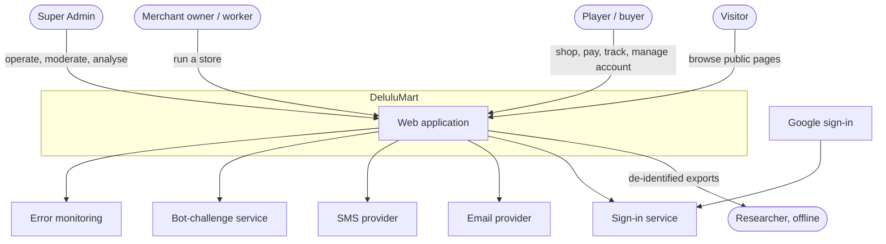
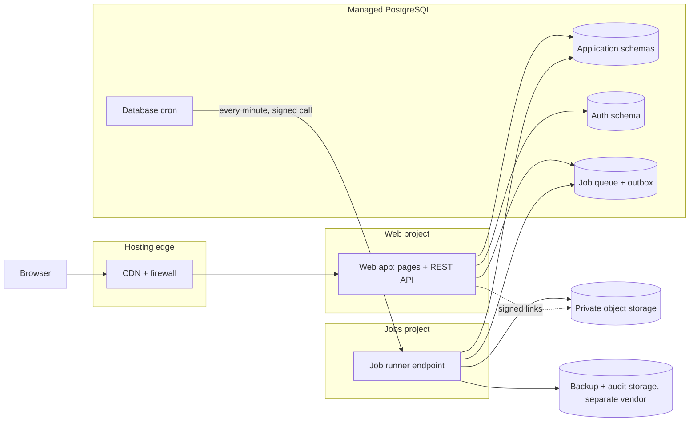
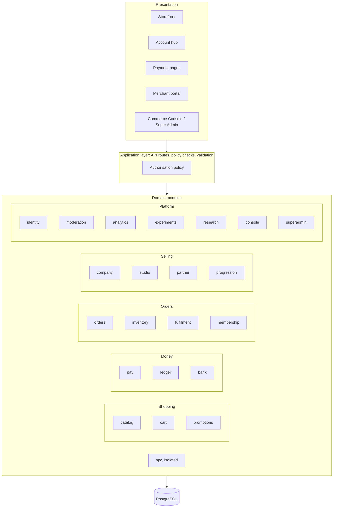
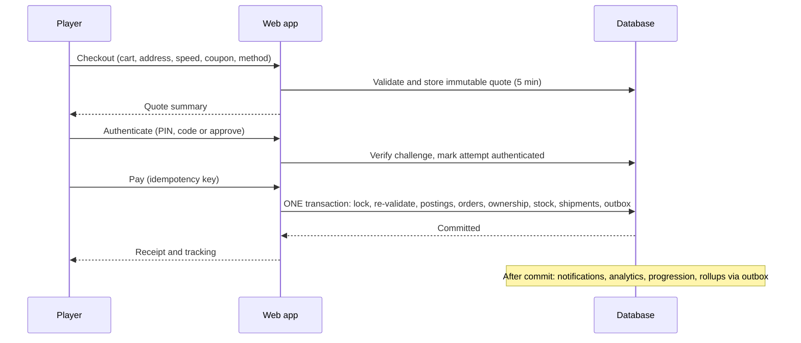
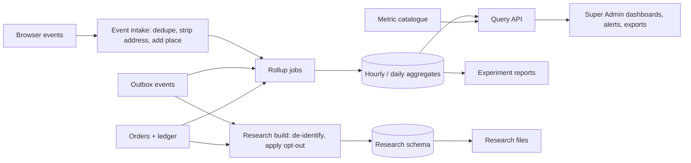
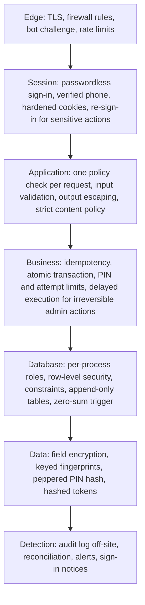

# DeluluMart — High-Level Design

Scope: the system as decided to date — PRD v1.4 plus Revision 1.5 (`docs/prd-v1.5-revision.md`).
Companions: `low-level-design.md` (schemas, algorithms, APIs) and `../architecture.md` (the decision record with reasoning and alternatives).
Where this document and the decision record differ, this document reflects the latest decision.

---

## 1. What is being built

A pretend-commerce web application. Every player gets ₹100 crore of fictional money, shops for imaginary products with a realistic cart, payment and delivery experience, and can become a merchant who lists products for other players. Behind the game it is also a research and experimentation platform.

| In scope for this release | Out of scope |
|---|---|
| Storefront, cart, checkout | Real money, real payments, real shipping |
| Account hub: orders, payments, wallet, cards, addresses | AI-assisted product creation |
| Payment simulator: four methods, card number and PIN, bank code step | Cancellations, returns, player-initiated refunds |
| Simulated delivery: Standard, Express, Zap; Delulu Plus membership | Staff accounts and roles |
| Merchant portal: products, pricing, coupons, shipping, orders, finances, analytics, warehouses, team | Gifting, resale, auctions, wallet transfers |
| Back office (Commerce Console) run by one Super Admin, with analytics engine and dashboards | Tax, invoicing, multi-currency |
| Experiments and de-identified research data | Native mobile apps |
| NPC simulated buyers, isolated from the player economy | |

### Design priorities, in order

1. **Security and privacy.** Enforced in the server and again in the database.
2. **Correctness of money, stock and ownership.** One atomic transaction; nothing is eventually consistent on the write path.
3. **Zero running cost** for the build and beta, with a clear path to paid infrastructure.
4. **Speed of building** by one person with AI coding tools.
5. **Scalability** by adding capacity at defined seams, not by redesign.

### Sizing assumptions

| Quantity | Beta | Design ceiling before the first scaling step |
|---|---|---|
| Registered accounts | 200–500 | about 10,000 |
| Peak checkout rate | under 1 per second | 20 per second (PRD test load) |
| Concurrent browsing sessions | tens | 100+ (served mostly from cache) |
| Listings | hundreds | tens of thousands |
| Orders per day | hundreds | tens of thousands |
| Database size | under 300 MB | 500 MB on the free tier is the first hard limit |

The free database's 500 MB cap is the tightest constraint. Raw analytics events are the largest consumer, so on the zero-cost profile raw events stay in the database for 30 days and are then archived, de-identified, to object storage; pre-computed aggregates are kept.

---

## 2. System context

There is no payment processor, card network, bank, courier, map or address service, and no AI provider. Everything that looks like one is simulated inside the application.

---

## 3. Containers

| Container | Technology | Responsibility |
|---|---|---|
| Web app | Next.js (TypeScript) on serverless hosting, Mumbai region | Renders all pages; serves the REST API; runs every synchronous command including payment |
| Job runner | Same codebase, separate deployment, one authenticated endpoint | Drains the queue in short batches: outbox fan-out, rollups, sweeps, exports, reconciliation, deletion, research builds |
| PostgreSQL | Managed Postgres, Mumbai | System of record for everything; also the job queue, the outbox and the scheduler |
| Sign-in service | Managed auth bundled with the database | Email-link and Google sign-in, phone verification, sessions, Super Admin passkey |
| Private object storage | Bundled storage | Exports, statements, research files |
| Backup and audit storage | Separate vendor | Encrypted hourly database dumps; off-site copy of the audit log |
| CDN and firewall | Hosting edge | Caches public pages and static assets; approximate place of each request; basic filtering |

One codebase, two deployments. The web deployment holds session and field-encryption keys; the jobs deployment holds the worker database role and service keys. Neither holds the other's secrets.

---

## 4. Logical architecture

The application is a modular monolith. Each module owns its tables and exposes commands and queries; modules do not reach into each other's tables.

| Group | Modules | What they own |
|---|---|---|
| Shopping | `catalog`, `cart`, `promotions` | Products and versions, search, saves, shelves; carts; coupons, campaigns, sale prices |
| Money | `ledger`, `bank`, `pay` | Accounts, journals, wallets, grants; bank accounts, cards, statements; checkout sessions, attempts, authentication challenges |
| Orders | `orders`, `inventory`, `fulfilment`, `membership` | Order groups, seller orders, ownership, reversals; warehouses and stock units; addresses, shipments, delivery speeds; Delulu Plus |
| Selling | `company`, `studio`, `partner`, `progression` | Companies, memberships, invitations; drafts; portal read models; creator, brand and collector progression |
| Platform | `identity`, `moderation`, `analytics`, `experiments`, `research`, `console`, `superadmin` | Profiles and personal data; screening, cases, appeals; events, metric catalogue, aggregates; experiment definitions and assignment; de-identified dataset; configuration; owner-only commands |
| Isolated | `npc` | Simulated buyers in a separate schema with no access to money or stock |

Rules that hold across the whole design:

- Only `ledger` writes money tables. Only `pay` orchestrates a payment. One pricing function computes every amount.
- `npc` cannot import or write `ledger`, `orders` or `inventory`; the database enforces the same with role privileges.
- `partner`, `analytics` and `research` are read-only over other modules' data.
- Security-critical modules (`identity` policy, `moderation`, `npc` labelling) never read experiment state.

---

## 5. Key flows

### 5.1 Browsing

Public pages (home, category, search, product, store, deals) are rendered without any viewer data and cached at the CDN. The browser then fetches the personal overlay (balance, owned and saved state, cart count, member pricing) from uncached endpoints. Publishing, hiding, repricing or selling out purges the affected pages by tag.

### 5.2 Checkout and payment

Authentication moves no money and places no hold. Payment either commits everything or nothing. A lost response is recovered by repeating the request with the same key.

### 5.3 Delivery

Shipment stage times are fixed when the order commits. The current stage is calculated from those times and the clock whenever the tracking page is viewed, so no job has to run for tracking to be right. A minute sweep only sends "delivered" notifications.

### 5.4 Selling

A player unlocks creator access (by spending below ₹1 crore or by the free Inventor Passport), registers a company through DeluluPay, writes a listing, picks a template illustration, sets price, stock mode, speeds and coupons, and submits. Text screening and, where needed, the Super Admin's review decide publication. Sales credit the owner's bank account less the 5% fee.

### 5.5 Analytics, experiments and research

---

## 6. Data architecture

One PostgreSQL database, partitioned by schema and by database role.

| Schema | Holds | Who may write |
|---|---|---|
| `auth` | Identities, sessions, email, phone (managed by the sign-in service) | Sign-in service |
| `core` | Profiles, companies, products, carts, orders, shipments, inventory, coupons, memberships, moderation, configuration | Web, jobs |
| `ledger` | Accounts, journals, postings, wallets, grants | Web, jobs — insert-only except the wallet projection |
| `private` | Field-encrypted birthdate and addresses | Web only |
| `sandbox` | NPC actors, runs, simulated orders | NPC role only |
| `analytics` | Raw events, aggregates, metric versions, experiments, exposures | Web (events), jobs |
| `audit` | Audit log, outbox, pending actions | Insert-only for application roles |
| `research` | De-identified dataset | Jobs (build); research role reads |

Principles:

- **Money** is integer paise in 64-bit columns; journals always sum to zero; the wallet is a cached projection checked daily against postings.
- **Immutability**: journals, postings, order snapshots, audit entries and shipment events are append-only. Corrections are new entries.
- **Versioned configuration**: fees, prices, thresholds, delivery terms and experiment variants are versions; each order records the version it used.
- **Derived data is rebuildable**: aggregates, rankings, progression and the research dataset can be recomputed from authoritative records.
- **Personal data** is minimised and tiered: email and phone in the sign-in service; birthdate and address field-encrypted; nothing personal in analytics, logs or research.

---

## 7. Cross-cutting design

### 7.1 Security layers

A failure in one layer is caught by the next. The attack-by-attack table and remaining weak points are in `../architecture.md` §8.7–8.8.

### 7.2 Caching

Public content is cached at the CDN with tag invalidation; private content is never shared-cached; no cached value authorises anything.

### 7.3 Asynchronous work

Commands write an outbox row in the same transaction. The database's scheduler calls the job runner every minute; the runner drains queued work in time-boxed batches. Every consumer is idempotent, so retries and replays are safe. Nothing on the purchase path waits for a job.

### 7.4 Observability

Structured logs without personal data, error monitoring, uptime checks, a daily ledger and inventory reconciliation, metric alerts in the command centre, and free-tier usage tracking.

### 7.5 Experimentation

Deterministic assignment by hashing; exposure recorded once; money-related variants are configuration versions; guardrails stop an experiment automatically.

---

## 8. Deployment

### 8.1 Zero-cost profile (current)

| Concern | Service |
|---|---|
| Web and jobs | Two projects on a free serverless plan, Mumbai functions |
| Database, auth, storage | Free managed Postgres plan, Mumbai; two projects (staging, production) |
| Backups, audit copy | Free object-storage allowance at a separate vendor |
| Bot challenge, email, errors, uptime, CI | Free tiers |
| SMS | The one paid item: about one message per sign-up |

### 8.2 Environments

| Environment | Purpose | Data |
|---|---|---|
| Local | Development and automated tests against a real local database stack | Fixtures |
| Staging | Release candidate, load and failure rehearsals, restore tests | Synthetic only |
| Production | Players | Real |

### 8.3 Delivery

Pull request checks (types, lint, module boundaries, unit, concurrency, authorisation, accessibility, scans) → merge → migrate and deploy staging → smoke test → manual promotion to production. Migrations are backward compatible so the previous build can be redeployed.

### 8.4 Paid target profile

AWS Mumbai: container service for web and worker, Multi-AZ managed Postgres with point-in-time recovery, object storage, CDN and managed firewall, private networking. Same code; only provider adapters and configuration change.

---

## 9. Availability and failure behaviour

| Failure | Behaviour |
|---|---|
| Database down | Cached public pages keep serving; purchases, sign-up and grants show maintenance |
| Job runner down | Purchases unaffected; notifications, aggregates and progression catch up later |
| Sign-in service down | Existing sessions continue; new sign-ins wait |
| SMS provider down | New sign-ups cannot complete phone verification; existing players unaffected |
| Email provider down | Google sign-in still works |
| Cache purge fails | Short safety-net expiry and a retry job |
| Integrity alarm (ledger or stock mismatch) | Purchases and grants switch off automatically; browse-only mode |
| Super Admin unavailable | Publication pauses after 48 hours unreviewed; heavily reported listings auto-hide |

Targets: 99.5% monthly availability for public browsing; checkout technical success at least 99.5%; purchase p95 under 800 ms; public page LCP under 2.5 s on mid-range mobile. Recovery on the zero-cost profile: up to one hour of data loss, restore within four hours.

---

## 10. Scaling path

| Order | Trigger | Step |
|---|---|---|
| 1 | Database near 500 MB or real users depend on data | Paid database plan with backups |
| 2 | Function limits or commercial use | Paid hosting plan |
| 3 | Web latency | More web instances (stateless) |
| 4 | Connection pressure | Connection pooler |
| 5 | Portal, analytics and search compete with checkout | Read replica |
| 6 | Tables in the tens of millions of rows | Time partitioning and archiving |
| 7 | Queue or counters load the database | Dedicated queue and in-memory store |
| 8 | One seller or one drop dominates | Batched seller credits, per-product purchase queue |
| 9 | Catalog or analytics outgrow Postgres | Search index and analytical store fed from the outbox |

The money path stays a single-database transaction at every step.

---

## 11. Principal decisions and trade-offs

| Decision | Chosen | Trade-off accepted |
|---|---|---|
| Architecture style | Modular monolith | Less independent scaling per module; far less operational burden |
| Data store | One relational database | A single point of failure; in exchange, atomic money, stock and ownership |
| Queue | In the database | Lower throughput ceiling; transactional enqueue and no extra service |
| Hosting | Free serverless tiers | No point-in-time recovery, no private network, per-plan limits |
| Sign-in | Managed, passwordless, verified phone | Email and phone not field-encrypted; SMS cost |
| Payment simulator | One funding source behind four methods | Methods differ only in experience, not in accounting |
| Card number | Keyed one-way derivation including birthdate | Birthdate collected; number reveals nothing |
| Delivery | Time-computed, never fails | Less drama; no scheduler dependency |
| Checkout | All-or-nothing across sellers | A single sold-out line blocks the cart until re-confirmed |
| Refunds | Super Admin reversal only | Less realistic; protects the unlock gate |
| Back office | One Super Admin, delayed execution instead of approvals | Single point of human failure; simpler and smaller attack surface |
| Research | Notice-based, opt-out, de-identified | Open legal question on consent |
| Product creation | Manual text and templates, no AI | Less magic; no provider cost or AI safety surface |

---

## 12. Main risks

1. One person holds every power and reviews their own code.
2. Free-tier recovery and network limits.
3. The amount of personal data now collected, and research use without explicit consent.
4. Scope: six modules plus analytics and research for a solo builder; delivery is phased (Revision 1.5, R12).
5. AI-generated code in security-critical paths, mitigated by guarded-zone rules and database constraints.
