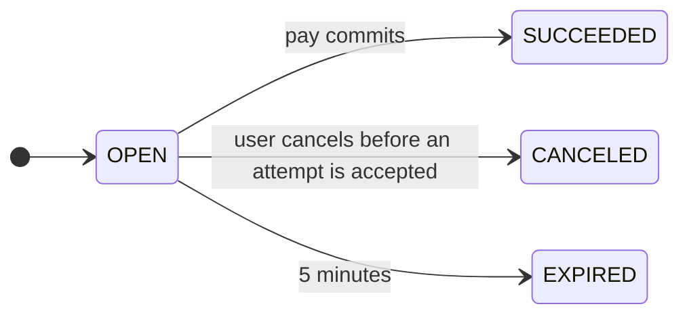
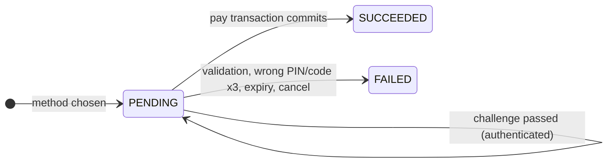
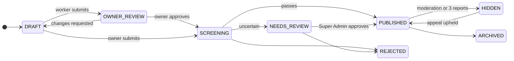
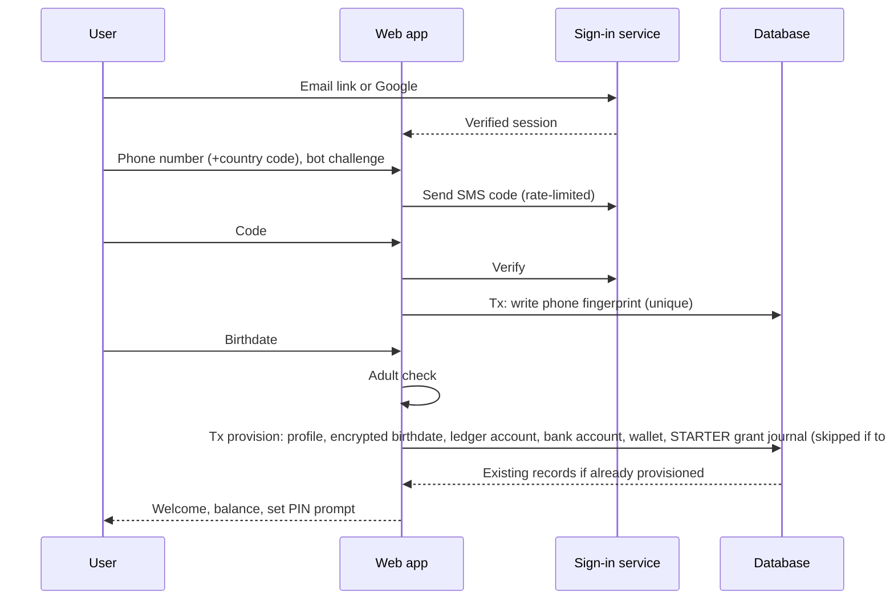
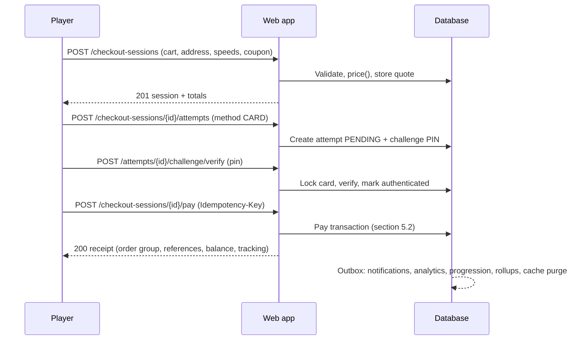
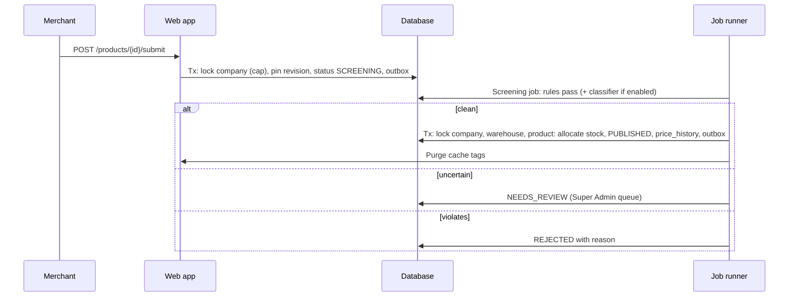

# DeluluMart — Low-Level Design

Companion to `high-level-design.md`. This document is the build reference: conventions, schema, constraints, algorithms, state machines, API contracts, jobs, caching keys and security details. Requirement ids (US-xx, §, R) refer to PRD v1.4 and Revision 1.5.

SQL is PostgreSQL. TypeScript signatures are illustrative of shape, not final code.

---

## 1. Conventions

| Topic | Rule |
|---|---|
| Identifiers | `uuid` (v7, time-ordered) primary keys generated in the application. Public URLs use these or a separate random slug; never sequential integers. |
| Money | `bigint` paise. Never floating point. JSON carries money as decimal strings. `₹1 = 100 paise`. |
| Constants | Starting grant `100_000_000_000` paise (₹100 crore). Creator threshold `1_000_000_000` paise (₹1 crore), strict less-than. Price bounds ₹100–₹100 crore, whole rupees. |
| Time | `timestamptz`, UTC. "UTC day" for relief and quotas; company time zone (default Asia/Kolkata) for portal reports. |
| Enums | Postgres `text` with `CHECK`, so values can be added by migration without type locks. |
| Soft state | No soft-delete flags on personal data; deletion is real. Business records use status columns. |
| Naming | Tables singular snake_case; `created_at`, `updated_at` where mutable; foreign keys `<table>_id`. |
| API | REST, JSON, under `/api/v1`. Mutations require `Idempotency-Key`. Errors use a stable code (section 8.3). |
| Config | Every tunable lives in `config_version`; code never hard-codes a fee, limit or threshold. |

---

## 2. Database roles and schemas

```sql
-- roles (created by migration; passwords from the secret store)
CREATE ROLE migrator   NOINHERIT;          -- owns objects; used only by the migration step
CREATE ROLE app_web    LOGIN;              -- web deployment
CREATE ROLE app_jobs   LOGIN;              -- job runner
CREATE ROLE npc_worker LOGIN;              -- NPC simulation only
CREATE ROLE research_ro LOGIN;             -- researchers, read-only on research schema

CREATE SCHEMA core; CREATE SCHEMA ledger; CREATE SCHEMA private;
CREATE SCHEMA sandbox; CREATE SCHEMA analytics; CREATE SCHEMA audit; CREATE SCHEMA research;

-- ledger: insert-only for the application
GRANT USAGE ON SCHEMA ledger TO app_web, app_jobs;
GRANT SELECT, INSERT ON ledger.journal, ledger.posting, ledger.grant_record TO app_web, app_jobs;
GRANT SELECT, INSERT, UPDATE ON ledger.wallet TO app_web, app_jobs;
-- no UPDATE/DELETE on journal, posting, grant_record for anyone but migrator

-- private data: web only
GRANT USAGE ON SCHEMA private TO app_web;
-- sandbox: NPC role only; NPC role has nothing on ledger/core write paths
GRANT USAGE ON SCHEMA sandbox TO npc_worker;
GRANT SELECT ON core.product_version TO npc_worker;
-- research: read-only
GRANT USAGE ON SCHEMA research TO research_ro;
GRANT SELECT ON ALL TABLES IN SCHEMA research TO research_ro;

-- managed-database built-in public roles must have nothing
REVOKE ALL ON ALL TABLES IN SCHEMA core, ledger, private, sandbox, analytics, audit, research FROM anon, authenticated;
```

Row-level security is enabled on every table. The web process sets two transaction-local settings on each request and policies read them:

```sql
-- set by the data-access layer at the start of every transaction
SELECT set_config('app.user_id', $1, true), set_config('app.company_id', $2, true);

ALTER TABLE private.address ENABLE ROW LEVEL SECURITY;
CREATE POLICY address_owner ON private.address
  USING (user_id = current_setting('app.user_id')::uuid)
  WITH CHECK (user_id = current_setting('app.user_id')::uuid);

ALTER TABLE core.seller_order ENABLE ROW LEVEL SECURITY;
CREATE POLICY seller_order_parties ON core.seller_order FOR SELECT
  USING (buyer_user_id = current_setting('app.user_id')::uuid
      OR company_id   = nullif(current_setting('app.company_id', true), '')::uuid);
```

`app.company_id` is set by the server only after it has confirmed the actor is that company's **owner**; workers never get it for order or finance tables.

---

## 3. Schema

Key tables in full; the remainder are listed in 3.9.

### 3.1 Identity

```sql
CREATE TABLE core.user_profile (
  id                uuid PRIMARY KEY,                  -- = auth.users.id
  handle            text UNIQUE,                       -- public, 3-24 [a-z0-9-]
  status            text NOT NULL DEFAULT 'ACTIVE' CHECK (status IN ('ACTIVE','SUSPENDED','DELETED')),
  role              text NOT NULL DEFAULT 'PLAYER' CHECK (role IN ('PLAYER','SUPER_ADMIN')),
  is_test_account   boolean NOT NULL DEFAULT false,    -- buyer_source STAFF
  email_fingerprint bytea NOT NULL UNIQUE,             -- HMAC of normalised email
  phone_fingerprint bytea UNIQUE,                      -- HMAC of E.164; null until verified
  phone_verified_at timestamptz,
  is_adult          boolean NOT NULL DEFAULT false,    -- derived from birthdate at onboarding
  research_opt_out  boolean NOT NULL DEFAULT false,
  privacy           jsonb NOT NULL DEFAULT '{}',
  provisioned_at    timestamptz,
  created_at        timestamptz NOT NULL DEFAULT now()
);
CREATE UNIQUE INDEX one_super_admin ON core.user_profile (role) WHERE role = 'SUPER_ADMIN';
-- at most one Super Admin row in this release; the row is created by migration, never by the application

CREATE TABLE private.user_secret (                      -- web role only
  user_id        uuid PRIMARY KEY REFERENCES core.user_profile(id) ON DELETE CASCADE,
  birthdate_enc  bytea NOT NULL,                        -- AES-256-GCM, key id prefixed
  created_at     timestamptz NOT NULL DEFAULT now()
);

CREATE TABLE private.address (
  id         uuid PRIMARY KEY,
  user_id    uuid NOT NULL REFERENCES core.user_profile(id) ON DELETE CASCADE,
  kind       text NOT NULL CHECK (kind IN ('REAL','FICTIONAL')),
  label      text NOT NULL CHECK (label IN ('HOME','WORK','OTHER')),
  payload_enc bytea,                                    -- REAL: encrypted JSON {name,line1,line2,city,state,pincode}
  locality_id int REFERENCES core.fictional_locality(id),   -- FICTIONAL
  landmark_id int REFERENCES core.fictional_landmark(id),
  created_at timestamptz NOT NULL DEFAULT now(),
  CHECK ((kind='REAL' AND payload_enc IS NOT NULL) OR (kind='FICTIONAL' AND locality_id IS NOT NULL))
);
-- max five per user enforced in the insert command under a row lock on user_profile

CREATE TABLE core.identity_tombstone (
  fingerprint bytea PRIMARY KEY, kind text NOT NULL CHECK (kind IN ('EMAIL','PHONE')),
  expires_at  timestamptz NOT NULL
);
```

### 3.2 Ledger

```sql
CREATE TABLE ledger.ledger_account (
  id       uuid PRIMARY KEY,
  type     text NOT NULL CHECK (type IN ('USER','MINT','SINK')),
  user_id  uuid UNIQUE REFERENCES core.user_profile(id),
  CHECK ((type='USER') = (user_id IS NOT NULL))
);

CREATE TABLE ledger.journal (
  id              uuid PRIMARY KEY,
  event_type      text NOT NULL CHECK (event_type IN
    ('STARTER_GRANT','RELIEF_GRANT','PURCHASE','COMPANY_REGISTRATION','WAREHOUSE_PURCHASE',
     'MEMBERSHIP','REVERSAL','COMPENSATION','ACCOUNT_RETIREMENT')),
  config_version  int  NOT NULL REFERENCES core.config_version(id),
  funding_bank_account_id uuid,
  order_group_id  uuid, reversal_of uuid REFERENCES ledger.journal(id),
  idempotency_ref uuid,
  created_at      timestamptz NOT NULL DEFAULT now()
);

CREATE TABLE ledger.posting (
  id          bigint GENERATED ALWAYS AS IDENTITY PRIMARY KEY,
  journal_id  uuid NOT NULL REFERENCES ledger.journal(id),
  account_id  uuid NOT NULL REFERENCES ledger.ledger_account(id),
  amount      bigint NOT NULL CHECK (amount <> 0),       -- signed paise
  seller_order_id uuid,                                  -- attribution for statements
  memo        text NOT NULL
);
CREATE INDEX posting_account ON ledger.posting (account_id, id);

CREATE TABLE ledger.wallet (
  account_id       uuid PRIMARY KEY REFERENCES ledger.ledger_account(id),
  available_paise  bigint NOT NULL CHECK (available_paise >= 0),
  version          bigint NOT NULL DEFAULT 0,
  reconciled_at    timestamptz
);
-- wallet rows exist for USER accounts only; MINT and SINK have no cached balance

CREATE TABLE ledger.grant_record (
  id uuid PRIMARY KEY, user_id uuid NOT NULL, journal_id uuid NOT NULL REFERENCES ledger.journal(id),
  type text NOT NULL CHECK (type IN ('STARTER','RELIEF','COMPENSATION','PROMO')),
  amount bigint NOT NULL, utc_day date
);
CREATE UNIQUE INDEX one_starter ON ledger.grant_record (user_id) WHERE type='STARTER';
CREATE UNIQUE INDEX one_relief_per_day ON ledger.grant_record (user_id, utc_day) WHERE type='RELIEF';
```

Zero-sum and append-only enforcement:

```sql
CREATE FUNCTION ledger.assert_zero_sum() RETURNS trigger LANGUAGE plpgsql AS $$
BEGIN
  IF (SELECT COALESCE(SUM(amount),0) FROM ledger.posting WHERE journal_id = NEW.journal_id) <> 0 THEN
    RAISE EXCEPTION 'journal % does not sum to zero', NEW.journal_id;
  END IF;
  RETURN NULL;
END $$;
CREATE CONSTRAINT TRIGGER posting_zero_sum AFTER INSERT ON ledger.posting
  DEFERRABLE INITIALLY DEFERRED FOR EACH ROW EXECUTE FUNCTION ledger.assert_zero_sum();

CREATE FUNCTION audit.forbid_change() RETURNS trigger LANGUAGE plpgsql AS $$
BEGIN RAISE EXCEPTION '% is append-only', TG_TABLE_NAME; END $$;
CREATE TRIGGER no_change BEFORE UPDATE OR DELETE ON ledger.posting FOR EACH ROW EXECUTE FUNCTION audit.forbid_change();
-- same trigger on ledger.journal, audit.audit_log, core.shipment_event, core.stock_movement
```

### 3.3 Bank, cards, payments

```sql
CREATE TABLE core.bank_account (
  id uuid PRIMARY KEY, user_id uuid NOT NULL, bank_code text NOT NULL DEFAULT 'DELULU',
  ledger_account_id uuid NOT NULL UNIQUE REFERENCES ledger.ledger_account(id),
  alias text NOT NULL UNIQUE, upi_style_id text NOT NULL UNIQUE,     -- e.g. handle@delulu
  status text NOT NULL DEFAULT 'OPEN', UNIQUE (user_id, bank_code)
);

CREATE TABLE core.virtual_card (
  id uuid PRIMARY KEY, user_id uuid NOT NULL, bank_account_id uuid NOT NULL REFERENCES core.bank_account(id),
  sequence int NOT NULL, card_number char(16) NOT NULL UNIQUE,       -- display identifier, not a credential
  status text NOT NULL CHECK (status IN ('ACTIVE','FROZEN','REPLACED')),
  merchant_scope text NOT NULL DEFAULT 'DELULUMART',
  pin_hash text, pin_salt bytea, pin_set_at timestamptz,
  failed_pin_count int NOT NULL DEFAULT 0, pin_locked_until timestamptz,
  UNIQUE (bank_account_id, sequence)
);
CREATE UNIQUE INDEX one_active_card ON core.virtual_card (bank_account_id) WHERE status IN ('ACTIVE','FROZEN');

CREATE TABLE core.checkout_session (
  id uuid PRIMARY KEY, user_id uuid NOT NULL,
  type text NOT NULL CHECK (type IN ('PRODUCT_PURCHASE','COMPANY_REGISTRATION','WAREHOUSE_PURCHASE','MEMBERSHIP_PURCHASE')),
  state text NOT NULL DEFAULT 'OPEN' CHECK (state IN ('OPEN','SUCCEEDED','CANCELED','EXPIRED')),
  quote jsonb NOT NULL,                 -- immutable: lines, prices, versions, coupon, delivery, totals
  total_paise bigint NOT NULL, config_version int NOT NULL,
  expires_at timestamptz NOT NULL, created_at timestamptz NOT NULL DEFAULT now()
);

CREATE TABLE core.payment_attempt (
  id uuid PRIMARY KEY, session_id uuid NOT NULL REFERENCES core.checkout_session(id), user_id uuid NOT NULL,
  method text NOT NULL CHECK (method IN ('CARD','DELULUPAY_ID','NET_BANKING','BALANCE')),
  card_id uuid, state text NOT NULL DEFAULT 'PENDING' CHECK (state IN ('PENDING','SUCCEEDED','FAILED')),
  authenticated_at timestamptz, failure_code text, reference text NOT NULL UNIQUE,
  created_at timestamptz NOT NULL DEFAULT now()
);
CREATE UNIQUE INDEX one_success_per_session ON core.payment_attempt (session_id) WHERE state='SUCCEEDED';

CREATE TABLE core.payment_challenge (
  attempt_id uuid PRIMARY KEY REFERENCES core.payment_attempt(id),
  kind text NOT NULL CHECK (kind IN ('PIN','CODE','APPROVE')),
  code_hash bytea, expires_at timestamptz NOT NULL, attempts_used int NOT NULL DEFAULT 0, passed_at timestamptz
);

CREATE TABLE core.idempotency_record (
  user_id uuid NOT NULL, command text NOT NULL, key text NOT NULL,
  request_hash bytea NOT NULL, status int, response jsonb,
  created_at timestamptz NOT NULL DEFAULT now(), PRIMARY KEY (user_id, command, key)
);
```

### 3.4 Catalog and inventory

```sql
CREATE TABLE core.product (
  id uuid PRIMARY KEY, company_id uuid,                       -- null for platform seed
  seller_type text NOT NULL CHECK (seller_type IN ('USER','SEED')),
  status text NOT NULL CHECK (status IN ('DRAFT','SCREENING','NEEDS_REVIEW','PUBLISHED','REJECTED','HIDDEN','ARCHIVED')),
  current_version_id uuid, category text NOT NULL,
  inventory_mode text NOT NULL CHECK (inventory_mode IN ('STANDARD_STOCKED','EXCLUSIVE','UNLIMITED_SEED')),
  exclusive_supply int, available_units int NOT NULL DEFAULT 0 CHECK (available_units >= 0),
  offers_express boolean NOT NULL DEFAULT false, free_standard_delivery boolean NOT NULL DEFAULT false,
  zap_flag boolean NOT NULL DEFAULT false,                    -- seed items only
  published_at timestamptz,
  CHECK ((seller_type='SEED') = (company_id IS NULL))
);

CREATE TABLE core.product_version (                           -- immutable
  id uuid PRIMARY KEY, product_id uuid NOT NULL REFERENCES core.product(id), revision int NOT NULL,
  name text NOT NULL, hook text, description text NOT NULL, alt_text text NOT NULL,
  template_id int NOT NULL, price_paise bigint NOT NULL CHECK (price_paise BETWEEN 10000 AND 100000000000 AND price_paise % 100 = 0),
  author_user_id uuid, search tsvector, UNIQUE (product_id, revision)
);

CREATE TABLE core.warehouse (
  id uuid PRIMARY KEY, company_id uuid NOT NULL, kind text NOT NULL CHECK (kind IN ('STARTER','PURCHASED')),
  capacity int NOT NULL DEFAULT 100, used int NOT NULL DEFAULT 0 CHECK (used BETWEEN 0 AND capacity),
  zap_hub boolean NOT NULL DEFAULT false
);
CREATE UNIQUE INDEX one_starter_wh ON core.warehouse (company_id) WHERE kind='STARTER';
CREATE UNIQUE INDEX one_zap_hub   ON core.warehouse (company_id) WHERE zap_hub;

CREATE TABLE core.inventory_unit (
  id uuid PRIMARY KEY, product_id uuid NOT NULL, warehouse_id uuid NOT NULL,
  serial int,                                                  -- exclusive editions
  state text NOT NULL CHECK (state IN ('AVAILABLE','ISSUED','RETIRED_UNSOLD','REVOKED_ISSUED')),
  order_line_id uuid, UNIQUE (product_id, serial)
);
CREATE INDEX unit_pick ON core.inventory_unit (product_id, warehouse_id, serial) WHERE state='AVAILABLE';
```

### 3.5 Orders, ownership, shipments

```sql
CREATE TABLE core.order_group (
  id uuid PRIMARY KEY, buyer_user_id uuid NOT NULL, session_id uuid NOT NULL UNIQUE,
  payment_attempt_id uuid NOT NULL UNIQUE, journal_id uuid NOT NULL UNIQUE,
  buyer_source text NOT NULL CHECK (buyer_source IN ('PLAYER','STAFF')),
  total_paise bigint NOT NULL, config_version int NOT NULL, geo jsonb, created_at timestamptz NOT NULL DEFAULT now()
);

CREATE TABLE core.seller_order (
  id uuid PRIMARY KEY, order_group_id uuid NOT NULL REFERENCES core.order_group(id),
  buyer_user_id uuid NOT NULL, company_id uuid, seller_type text NOT NULL,
  list_paise bigint NOT NULL, seller_discount_paise bigint NOT NULL DEFAULT 0,
  platform_discount_paise bigint NOT NULL DEFAULT 0, fee_paise bigint NOT NULL,
  delivery_fee_buyer_paise bigint NOT NULL DEFAULT 0, delivery_fee_seller_paise bigint NOT NULL DEFAULT 0,
  net_paise bigint NOT NULL, status text NOT NULL DEFAULT 'COMPLETED' CHECK (status IN ('COMPLETED','REVERSED')),
  qualifies_for_progression boolean NOT NULL DEFAULT true
);

CREATE TABLE core.order_line (
  id uuid PRIMARY KEY, seller_order_id uuid NOT NULL REFERENCES core.seller_order(id),
  product_id uuid NOT NULL, product_version_id uuid NOT NULL, snapshot jsonb NOT NULL,
  list_paise bigint NOT NULL, seller_discount_paise bigint NOT NULL, platform_discount_paise bigint NOT NULL,
  fee_paise bigint NOT NULL, inventory_unit_id uuid, edition_serial int
);

CREATE TABLE core.ownership (
  id uuid PRIMARY KEY, user_id uuid NOT NULL, product_id uuid NOT NULL, order_line_id uuid NOT NULL UNIQUE,
  state text NOT NULL DEFAULT 'ACTIVE' CHECK (state IN ('ACTIVE','REVOKED','UNAVAILABLE')),
  UNIQUE (user_id, product_id)                                 -- includes revoked: no rebuy
);

CREATE TABLE core.shipment (
  id uuid PRIMARY KEY, seller_order_id uuid NOT NULL UNIQUE REFERENCES core.seller_order(id),
  speed text NOT NULL CHECK (speed IN ('STANDARD','EXPRESS','ZAP')),
  address_id uuid REFERENCES private.address(id) ON DELETE SET NULL,
  placed_at timestamptz NOT NULL, packed_at timestamptz NOT NULL, shipped_at timestamptz NOT NULL,
  out_at timestamptz NOT NULL, delivered_at timestamptz NOT NULL,
  cancelled_at timestamptz, delivered_notified boolean NOT NULL DEFAULT false
);
CREATE INDEX shipment_due ON core.shipment (delivered_at) WHERE NOT delivered_notified AND cancelled_at IS NULL;
```

### 3.6 Promotions and membership

```sql
CREATE TABLE core.coupon (
  id uuid PRIMARY KEY, scope text NOT NULL CHECK (scope IN ('MERCHANT','PLATFORM')),
  company_id uuid, campaign_id uuid, code_normalised text NOT NULL,
  kind text NOT NULL CHECK (kind IN ('PERCENT','FLAT')), value bigint NOT NULL,
  min_spend_paise bigint NOT NULL DEFAULT 0, starts_at timestamptz, ends_at timestamptz,
  max_redemptions int, redeemed int NOT NULL DEFAULT 0, is_public boolean NOT NULL DEFAULT false,
  status text NOT NULL DEFAULT 'ACTIVE',
  CHECK ((scope='MERCHANT') = (company_id IS NOT NULL)),
  CHECK (kind <> 'PERCENT' OR value BETWEEN 1 AND 90),
  CHECK (max_redemptions IS NULL OR redeemed <= max_redemptions)
);
CREATE UNIQUE INDEX coupon_code ON core.coupon (COALESCE(company_id,'00000000-0000-0000-0000-000000000000'), code_normalised) WHERE status='ACTIVE';

CREATE TABLE core.coupon_redemption (
  coupon_id uuid NOT NULL REFERENCES core.coupon(id), user_id uuid NOT NULL,
  order_group_id uuid NOT NULL, discount_paise bigint NOT NULL, PRIMARY KEY (coupon_id, user_id)
);

CREATE TABLE core.promo_campaign (
  id uuid PRIMARY KEY, name text NOT NULL, budget_paise bigint NOT NULL,
  spent_paise bigint NOT NULL DEFAULT 0 CHECK (spent_paise <= budget_paise), status text NOT NULL
);

CREATE TABLE core.membership (
  id uuid PRIMARY KEY, user_id uuid NOT NULL, starts_at timestamptz NOT NULL, ends_at timestamptz NOT NULL,
  journal_id uuid NOT NULL UNIQUE,
  EXCLUDE USING gist (user_id WITH =, tstzrange(starts_at, ends_at) WITH &&)   -- no overlapping periods (needs the btree_gist extension)
);
```

### 3.7 Platform: outbox, audit, configuration, admin

```sql
CREATE TABLE audit.outbox (
  id bigint GENERATED ALWAYS AS IDENTITY PRIMARY KEY, event_id uuid NOT NULL UNIQUE,
  type text NOT NULL, aggregate_id uuid, payload jsonb NOT NULL, payload_version int NOT NULL,
  created_at timestamptz NOT NULL DEFAULT now(), relayed_at timestamptz
);
CREATE TABLE audit.consumer_receipt (consumer text NOT NULL, event_id uuid NOT NULL, PRIMARY KEY (consumer, event_id));

CREATE TABLE audit.audit_log (
  id bigint GENERATED ALWAYS AS IDENTITY PRIMARY KEY, actor_id uuid, actor_kind text NOT NULL CHECK (actor_kind IN ('SUPER_ADMIN','SYSTEM')),
  action text NOT NULL, target_type text, target_id text, reason text, detail jsonb,
  prev_hash bytea, row_hash bytea NOT NULL, created_at timestamptz NOT NULL DEFAULT now()
);

CREATE TABLE audit.pending_action (
  id uuid PRIMARY KEY, action text NOT NULL, payload jsonb NOT NULL, payload_hash bytea NOT NULL,
  requested_by uuid NOT NULL, not_before timestamptz NOT NULL,
  state text NOT NULL DEFAULT 'QUEUED' CHECK (state IN ('QUEUED','CANCELLED','EXECUTED','FAILED')),
  executed_at timestamptz
);

CREATE TABLE core.config_version (id int GENERATED ALWAYS AS IDENTITY PRIMARY KEY, values jsonb NOT NULL,
  effective_from timestamptz NOT NULL, created_by uuid, note text);
CREATE TABLE core.system_switch (name text PRIMARY KEY, enabled boolean NOT NULL, updated_at timestamptz NOT NULL);
-- names: purchases, signup_grants, publication, npc, payments_card, payments_netbanking, ...
```

### 3.8 Analytics, experiments

```sql
CREATE TABLE analytics.event (
  event_id uuid NOT NULL, type text NOT NULL, occurred_at timestamptz NOT NULL, received_at timestamptz NOT NULL DEFAULT now(),
  subject_pseudo_id bytea, session_id uuid, source text, props jsonb NOT NULL,
  geo_country text, geo_region text, geo_city text, PRIMARY KEY (occurred_at, event_id)
) PARTITION BY RANGE (occurred_at);                            -- daily partitions; dropped after retention

CREATE TABLE analytics.metric_daily (
  metric text NOT NULL, day date NOT NULL, dims jsonb NOT NULL, dims_hash bytea NOT NULL,
  value numeric NOT NULL, distinct_accounts int, def_version int NOT NULL, computed_at timestamptz NOT NULL,
  PRIMARY KEY (metric, day, dims_hash)
);                                                             -- metric_hourly has the same shape with an hour column

CREATE TABLE analytics.experiment (id uuid PRIMARY KEY, key text UNIQUE NOT NULL, salt bytea NOT NULL,
  status text NOT NULL CHECK (status IN ('DRAFT','RUNNING','STOPPED','ARCHIVED')),
  variants jsonb NOT NULL, audience jsonb NOT NULL, guardrails jsonb NOT NULL, starts_at timestamptz, ends_at timestamptz);
CREATE TABLE analytics.experiment_exposure (experiment_id uuid NOT NULL, subject_id uuid NOT NULL,
  variant text NOT NULL, exposed_at timestamptz NOT NULL DEFAULT now(), PRIMARY KEY (experiment_id, subject_id));
```

### 3.9 Remaining tables (same conventions)

`core.company`, `company_membership`, `invitation`, `draft`, `draft_review`, `creator_entitlement`, `passport_progress`, `brand_entitlement`, `formation_sponsorship`, `collector_progress`, `warehouse_purchase`, `stock_movement`, `exclusive_edition`, `cart`, `cart_line`, `save`, `shelf`, `price_history`, `payment_method_config`, `delivery_speed_config`, `fictional_locality`, `fictional_landmark`, `template_illustration`, `category`, `merchandising_slot`, `report`, `moderation_case`, `appeal`, `block`, `notification`, `export_job`, `rate_counter`, `alert_rule`, `alert_state`; `sandbox.npc_actor`, `simulation_run`, `simulation_order`; `research.*` (built tables).

---

## 4. Canonical lock order

Every transaction that touches more than one of these acquires them strictly in this order, ascending id within a class, with `SELECT … FOR UPDATE`, then re-validates.

| # | Lock | Purpose |
|---|---|---|
| 1 | `checkout_session` | One outcome per session |
| 2 | `coupon`, `promo_campaign` | Redemption cap, budget |
| 3 | `membership` (buyer's current) | Benefit validity |
| 4 | `company` rows | Slot, publication cap, seat and warehouse counters |
| 5 | `warehouse` rows | Capacity |
| 6 | `product` rows | Stock aggregate, current version |
| 7 | `inventory_unit` rows | Unit issue |
| 8 | `virtual_card` | Status, PIN counters |
| 9 | `wallet` rows | Balances: buyer and all sellers |
| 10 | `creator_entitlement`, `brand_entitlement`, relief counter | Progression |

Every such transaction starts with `SET LOCAL lock_timeout = '2s'; SET LOCAL statement_timeout = '5s';`. A timeout returns the retryable `BUSY` result; the client retries with the same idempotency key.

---

## 5. Algorithms

### 5.1 Pricing function (single source of every amount)

```ts
type LineIn  = { productId; sellerId | 'SEED'; listPaise: bigint; freeStdDelivery: boolean };
type Quote   = { lines: LineIn[]; coupon?: Coupon; speedBySeller: Map<SellerId, Speed>; isMember: boolean; cfg: Config };
type SellerOut = { sellerId; list; sellerDisc; platformDisc; fee; deliveryBuyer; deliverySeller; net };
type Priced  = { perSeller: SellerOut[]; buyerTotal: bigint; mint: bigint; sink: bigint; postings: Posting[] };

function price(q: Quote): Priced
```

Per line, with `L` the list price:

1. **Seller discount `Ds`** (merchant coupon, only on that company's lines): percent → `floor(L × pct / 100)`; flat → allocated across eligible lines in proportion to `L`, floored, remainder added to the last eligible line; capped so `L − Ds ≥ 10_000` paise.
2. **Platform discount `Dp`** (platform coupon): same allocation on `L − Ds`, capped at `L − Ds`.
3. **Fee `F`**: seed lines `0`; otherwise `floor((L − Ds) × feePercent / 100)` with `feePercent = 5`.

Per seller order:

4. **Delivery fee `S`** from speed and config; member adjustment (Standard and Express free, Zap half). If the speed is Standard and every line has merchant-funded free delivery, `S_seller = S, S_buyer = 0`; otherwise `S_buyer = S`.
5. **Postings**

| Account | Amount |
|---|---|
| Buyer | `−( Σ(L − Ds − Dp) + S_buyer )` |
| Seller (user company) | `+( Σ(L − Ds − F) − S_seller )` |
| MINT | `−ΣDp` (omitted when zero) |
| SINK | `+( ΣF + S_buyer + S_seller )`; for seed lines also `+Σ(L − Ds)` in place of a seller credit |

Invariants asserted in the function and by property tests: postings sum to zero; no amount negative; seller credit ≥ 0 (a merchant-funded fee larger than proceeds is rejected at quote time); `buyerTotal` equals the quote total.

### 5.2 Pay transaction

```ts
async function pay(sessionId, attemptId, idemKey, actor): Promise<PayResult> {
  return db.transaction(async tx => {
    await tx.execute(sql`SET LOCAL lock_timeout='2s'; SET LOCAL statement_timeout='5s'`);

    // 1. idempotency: insert-or-lock the record; return stored response if complete
    const idem = await idempotency.begin(tx, actor.id, 'pay', idemKey, hash(sessionId, attemptId));
    if (idem.completed) return idem.response;            // same key + same request
    // (same key + different request -> CONFLICT thrown inside begin)

    // 2. switches, read inside the transaction; unreadable => refuse
    await switches.require(tx, 'purchases');

    // 3. locks in canonical order
    const session  = await lock.session(tx, sessionId);                  // #1
    const attempt  = await attempts.get(tx, attemptId);
    const q        = session.quote;
    const coupon   = q.couponId && await lock.coupon(tx, q.couponId);    // #2 (+ campaign)
    const member   = await lock.membership(tx, actor.id);                // #3
    const companies= await lock.companies(tx, q.companyIds);             // #4
    const products = await lock.products(tx, q.productIds);              // #6
    const units    = await lock.pickUnits(tx, q.lines);                  // #7 lowest AVAILABLE serial; ZAP => hub warehouse
    const card     = attempt.cardId && await lock.card(tx, attempt.cardId);   // #8
    const wallets  = await lock.wallets(tx, [actor.accountId, ...q.sellerAccountIds]); // #9
    const ent      = await lock.entitlement(tx, actor.id);               // #10

    // 4. re-validate everything against locked state
    validate.session(session);                 // OPEN, not expired, owner
    validate.attempt(attempt);                 // PENDING, authenticated, method enabled, within limit
    validate.card(card, actor);                // ACTIVE, owner, scope
    validate.lines(q, products, units, actor); // published, version+price unchanged, not owned, not own/brand, not blocked
    validate.coupon(coupon, actor, q);         // active, window, cap, per-buyer unique, relationship rules, budget
    const priced = price(rebuildQuote(q, member, cfg(session.configVersion)));
    if (priced.buyerTotal !== session.totalPaise) throw fail('CART_CHANGED');
    if (wallets.buyer.available < priced.buyerTotal) throw fail('INSUFFICIENT_FUNDS');

    // 5. write
    const journal = await ledger.post(tx, 'PURCHASE', priced.postings, session);
    const group   = await orders.createGroup(tx, session, attempt, journal, priced, units); // seller orders, lines, ownership
    await inventory.issue(tx, units, group);            // unit ISSUED, product.available--, warehouse.used--, movements
    await promotions.redeem(tx, coupon, actor, group, priced);
    await fulfilment.createShipments(tx, group, q);     // fixed stage timestamps
    await ledger.applyWallets(tx, wallets, priced.postings);  // CHECK >= 0 is the last line of defence
    await progression.evaluateThreshold(tx, ent, wallets.buyer);  // strictly below ₹1 crore => unlock once
    await attempts.succeed(tx, attempt); await sessions.succeed(tx, session);
    await outbox.add(tx, 'purchase_completed', group);
    return idempotency.complete(tx, idem, receiptOf(group));
  });
}
```

A validation failure rolls back the business writes and, in a second short transaction, records the attempt as `FAILED` with its code and stores the failure under the idempotency key. Other checkout types (`COMPANY_REGISTRATION`, `WAREHOUSE_PURCHASE`, `MEMBERSHIP_PURCHASE`) use the same skeleton with their own validate/write steps.

### 5.3 Idempotency

```
begin(tx, user, command, key, requestHash):
  INSERT INTO idempotency_record (user_id, command, key, request_hash) ... ON CONFLICT DO NOTHING
  SELECT ... FOR UPDATE                      -- serialises concurrent duplicates
  if row.request_hash <> requestHash  -> throw CONFLICT
  if row.status IS NOT NULL           -> return {completed: true, response}
  return {completed: false}
```

Records are kept at least 24 hours. Clients create one key per user intent and reuse it for every retry, with exponential backoff and jitter.

### 5.4 Card number

```
input  : userId, birthdate (YYYY-MM-DD), sequence
key    : CARD_KEY (secret store)
h      = HMAC-SHA-256(CARD_KEY, userId || '|' || birthdate || '|' || sequence)
body   = (first 8 bytes of h as unsigned integer) mod 10^9, left-padded to 9 digits
first15= PREFIX(6 digits, begins with 0) || body
luhn   = standard Luhn check digit of first15
last   = (luhn + 5) mod 10                    -- always fails the Luhn check
number = first15 || last
```

Insert with the unique constraint; on conflict increment `sequence` and repeat. The number is stored; rotating `CARD_KEY` affects only future cards.

### 5.5 PIN

- Set: reject if not six digits, in the deny-list, all-same or sequential, or equal to any `DDMMYY`, `YYMMDD`, `DDMMYYYY`-derived six-digit arrangement of the owner's birthdate. Store `Argon2id(HMAC-SHA-256(PIN_PEPPER, pin), salt)`.
- Verify (under the card lock): if `pin_locked_until > now` → `PIN_LOCKED`. Constant-time compare. Wrong → `failed_pin_count++`; third wrong in an attempt fails the attempt; fifth consecutive sets `pin_locked_until = now + 15 min`. Correct → reset counter, mark the challenge passed.
- Change needs the current PIN; reset needs a session newer than five minutes.

### 5.6 Personal-data encryption and fingerprints

- Field encryption: AES-256-GCM, random 96-bit nonce, output `keyId || nonce || ciphertext || tag`. Key from the secret store, held by the web deployment only. Associated data binds the ciphertext to the row (`table:user_id`), so a value cannot be copied to another user.
- Fingerprints: `HMAC-SHA-256(IDENTITY_KEY, normalisedValue)`. Email normalisation: lowercase, trim; for Gmail domains remove dots and anything from `+`. Phone normalisation: E.164.

### 5.7 Delivery stages

```
durations (config): STANDARD 24h, EXPRESS 2h, ZAP 10min
placed_at = commit time T; packed = T + 10%; shipped = T + 30%; out = T + 70%; delivered = T + 100%
stage(now) = last stage whose timestamp <= now   (or CANCELLED if cancelled_at set)
```

### 5.8 Progression

- **Creator threshold**: inside the pay transaction, after wallet update: `available < 1_000_000_000` and no entitlement → insert entitlement (unique on user) with the order as evidence.
- **Brand**: idempotent recompute per company: `Σ(list − seller_discount)` over completed, non-reversed, PLAYER, qualifying seller orders and count of distinct buyers whose accounts are ≥ 24 h old; grant once at ≥ ₹10 crore and ≥ 5 buyers. Triggered by outbox and a 5-minute catch-up.
- **Collector level**: count distinct `product_id` in ACTIVE or UNAVAILABLE ownerships from qualifying PLAYER orders; thresholds 0/5/15/30/60/100.
- **Experiment assignment**: `bucket = first 4 bytes of HMAC-SHA-256(experiment.salt, subjectId) mod 10000`; map to variant by cumulative weight.

### 5.9 Reconciliation (daily, and on demand)

```sql
-- 1. every journal balances
SELECT journal_id FROM ledger.posting GROUP BY journal_id HAVING SUM(amount) <> 0;
-- 2. wallet equals postings
SELECT w.account_id FROM ledger.wallet w
JOIN (SELECT account_id, SUM(amount) s FROM ledger.posting GROUP BY account_id) p USING (account_id)
WHERE w.available_paise <> p.s;
-- 3. global conservation
SELECT SUM(amount) FROM ledger.posting;                         -- must be 0
-- 4. inventory: per edition, supply = AVAILABLE + ISSUED + RETIRED_UNSOLD + REVOKED_ISSUED; warehouse.used = count of AVAILABLE units
-- 5. every SUCCEEDED attempt has exactly one order group / registration / warehouse / membership and one journal
```

Any row returned raises an alert and turns off the `purchases` switch. Repairs are appended corrections, never edits.

---

## 6. State machines


*Checkout session.*


*Payment attempt. Displayed to the player as Created → Authenticating → Authorised → Captured / Failed.*


*Product listing.*

| Entity | States and transitions |
|---|---|
| Virtual card | `ACTIVE ⇄ FROZEN`; `ACTIVE/FROZEN → REPLACED` (new card created in the same transaction) |
| Shipment | `PLACED → PACKED → SHIPPED → OUT_FOR_DELIVERY → DELIVERED` by time; any undelivered stage `→ CANCELLED` by reversal |
| Inventory unit | `AVAILABLE → ISSUED → REVOKED_ISSUED`; `AVAILABLE → RETIRED_UNSOLD` |
| Invitation | `PENDING → ACCEPTED / DECLINED / REVOKED / EXPIRED` (7 days) |
| Pending action | `QUEUED → EXECUTED / CANCELLED / FAILED` |
| Experiment | `DRAFT → RUNNING → STOPPED → ARCHIVED` |
| Seller order | `COMPLETED → REVERSED` (once) |

---

## 7. Sequences

### 7.1 Sign-up and provisioning



### 7.2 Card checkout



### 7.3 Listing publication



---

## 8. API

### 8.1 Conventions

- Base path `/api/v1`. JSON. Authenticated by session cookie; state-changing requests also need the CSRF token and a same-origin `Origin`.
- `Idempotency-Key` header (UUID) required on every POST/PUT/PATCH/DELETE that creates a charge, entitlement, invitation, coupon, stock change or account.
- Pagination: `?cursor=&limit=` (max 50); response `{ items, nextCursor }`.
- Money fields end in `Paise` and are strings.
- Private responses carry `Cache-Control: private, no-store`.

### 8.2 Endpoints

| Area | Method and path | Notes |
|---|---|---|
| Onboarding | `POST /account/phone`, `POST /account/phone/verify`, `POST /account/birthdate`, `POST /account/provision` | Provision is idempotent on the identity |
| Catalog (public, cacheable) | `GET /catalog`, `GET /categories/{slug}`, `GET /products/{id}`, `GET /stores/{handle}`, `GET /search`, `GET /deals` | Approved versions only |
| Personal overlay | `GET /me/overlay?productIds=` | Owned, saved, blocked, member price, cart count, balance summary |
| Cart | `GET /cart`, `POST /cart/lines`, `DELETE /cart/lines/{id}`, `POST /cart/coupon`, `GET /cart/delivery-options` | Preview totals from `price()` |
| Checkout | `POST /checkout-sessions`, `GET /checkout-sessions/{id}`, `POST /checkout-sessions/{id}/attempts`, `POST /attempts/{id}/challenge` (issue code), `POST /attempts/{id}/challenge/verify`, `POST /checkout-sessions/{id}/pay`, `POST /checkout-sessions/{id}/cancel`, `GET /attempts/{id}` | |
| Account | `GET /account/orders`, `GET /orders/{id}`, `GET /orders/{id}/tracking`, `GET /account/payments`, `GET /bank-accounts/{id}/statement`, `GET/POST/PATCH/DELETE /account/addresses`, `GET /account/sessions`, `POST /account/export`, `POST /account/delete` | Owner only |
| Cards | `GET /cards`, `POST /cards/{id}/reveal`, `POST /cards/{id}/pin`, `PUT /cards/{id}/pin`, `POST /cards/{id}/pin/reset`, `POST /cards/{id}/freeze`, `/unfreeze`, `/replace` | Reveal and reset need a recent sign-in |
| Membership | `GET /membership`, `POST /checkout-sessions` with type `MEMBERSHIP_PURCHASE` | |
| Progression | `GET /me/creator-access`, `POST /passport/steps`, `GET /me/collector-progress`, `POST /relief/claim` | |
| Company | `POST /companies/quote`, checkout type `COMPANY_REGISTRATION`, `PATCH /stores/{id}`, `GET /companies/{id}/progression` | |
| Studio | `POST /drafts`, `PATCH /drafts/{id}`, `POST /drafts/{id}/submit-review`, `/approve`, `/request-changes`, `POST /products/{id}/submit`, `/archive` | |
| Merchant commerce | `PUT /products/{id}/sale-price`, `PUT /products/{id}/shipping`, `POST /products/{id}/stock/allocate-or-restock`, `/stock/retire`, `PUT /warehouses/{id}/zap-hub`, `POST /companies/{id}/coupons`, `PATCH /coupons/{id}` | Owner only |
| Team | `POST /brands/{id}/invitations`, `POST /invitations/{id}/accept|decline`, `DELETE /brands/{id}/members/{userId}` | |
| Portal reads | `GET /partner/companies/{id}/overview|products|orders|finances|analytics|inventory|tasks`, `POST …/exports`, `GET /partner/exports/{id}` | Company scope resolved on the server |
| Safety | `POST /reports`, `POST /appeals`, `POST /blocks` | |
| Events | `POST /events` (batch, deduplicated) | |
| Console | `/console/orders`, `/catalog`, `/merchandising`, `/customers`, `/merchants`, `/promotions`, `/shipping`, `/payments`, `/moderation`, `/economy`, `/experiments`, `/research`, `/analytics/query`, `/switches`, `/audit`, `/pending-actions`, `/reversals` | Admin hostname; Super Admin only |
| Internal | `POST /internal/jobs/run` | Jobs deployment; HMAC-signed by the database scheduler; not routable from the public site |

### 8.3 Error envelope and codes

```json
{ "error": { "code": "INSUFFICIENT_FUNDS", "message": "Not enough fictional balance.", "retryable": false, "details": {} } }
```

| Group | Codes |
|---|---|
| Access | `AUTH_REQUIRED`, `VERIFY_REQUIRED`, `PHONE_REQUIRED`, `UNDERAGE`, `FORBIDDEN`, `CREATOR_LOCKED`, `BRAND_LOCKED` |
| Identity | `PHONE_INVALID`, `PHONE_IN_USE`, `PHONE_CODE_FAILED` |
| Checkout | `CART_CHANGED`, `PRICE_CHANGED`, `PRODUCT_UNAVAILABLE`, `SOLD_OUT`, `ALREADY_OWNED`, `SELF_PURCHASE`, `CHECKOUT_EXPIRED`, `PAYMENT_PENDING`, `INSUFFICIENT_FUNDS`, `DELIVERY_UNAVAILABLE`, `BUSY` |
| Payment | `METHOD_UNAVAILABLE`, `METHOD_LIMIT_EXCEEDED`, `CARD_FROZEN`, `CARD_REPLACED`, `CARD_NOT_OWNED`, `MERCHANT_NOT_ALLOWED`, `PIN_NOT_SET`, `PIN_INCORRECT`, `PIN_LOCKED`, `PIN_WEAK`, `CHALLENGE_FAILED`, `CHALLENGE_EXPIRED`, `CHALLENGE_LOCKED` |
| Promotions | `COUPON_INVALID`, `COUPON_NOT_APPLICABLE`, `REFERENCE_PRICE_INELIGIBLE` |
| Selling | `COMPANY_FEE_REQUIRED`, `COMPANY_EXISTS`, `CONTENT_PENDING`, `SEATS_FULL`, `INVITE_EXPIRED`, `INVITE_WRONG_USER`, `OWNER_APPROVAL_REQUIRED`, `CAPACITY_EXCEEDED` |
| General | `VALIDATION_FAILED`, `CONFLICT`, `RATE_LIMITED`, `NOT_FOUND`, `MAINTENANCE`, `MEMBERSHIP_ACTIVE` |

`BUSY`, `RATE_LIMITED`, `PAYMENT_PENDING` and `MAINTENANCE` are retryable.

### 8.4 Example: create a checkout session

```http
POST /api/v1/checkout-sessions
Idempotency-Key: 0192f6a0-…

{ "type": "PRODUCT_PURCHASE", "source": "CART",
  "addressId": "0192…", "speeds": { "0192-seller-a…": "ZAP", "SEED": "STANDARD" },
  "couponCode": "MONSOON10" }
```

```json
{ "id": "0192…", "expiresAt": "2026-11-20T10:05:00Z", "configVersion": 7,
  "sellers": [ { "sellerId": "0192-seller-a…", "listPaise": "2000000000", "sellerDiscountPaise": "200000000",
                 "platformDiscountPaise": "0", "deliveryFeePaise": "2500000", "speed": "ZAP",
                 "etaAt": "2026-11-20T10:10:00Z", "lines": [ … ] } ],
  "totalPaise": "1802500000", "balanceAfterPaise": "98197500000",
  "methods": [ { "method": "CARD", "enabled": true }, { "method": "BALANCE", "enabled": true } ] }
```

---

## 9. Jobs

Runner contract: `POST /internal/jobs/run` is called every minute by the database scheduler with an HMAC signature and timestamp. The runner verifies the signature, takes an advisory lock so only one run is active, processes queued tasks for up to 45 seconds, and exits. It is also invoked right after an outbox insert for low latency.

| Task | Trigger | Idempotency |
|---|---|---|
| `outbox.relay` | Each run | Per-consumer receipt unique on `(consumer, event_id)` |
| `screening.run` | Outbox `listing_submitted`, profile edits | Keyed on revision id |
| `cache.purge` | Outbox publish/hide/price/stock events | Safe to repeat |
| `progression.brand`, `progression.collector` | Outbox + every 5 min | Full recompute |
| `rollup.hourly`, `rollup.daily` | Every 5 min / hourly; dirty buckets | Replace bucket |
| `shipment.delivered` | Every run | `delivered_notified` flag |
| `expire.sessions`, `expire.invitations`, `expire.reservations`, `expire.exports` | Every run | State check |
| `moderation.safety_net` | Hourly | Pauses publication if oldest pending > 48 h; hides at 3 qualifying reports |
| `pending_action.execute` | Every run | State `QUEUED` and `not_before <= now`, row lock |
| `guardrail.evaluate`, `alert.evaluate` | Every 5 min | State transition table |
| `reconcile.ledger`, `reconcile.inventory` | Daily + on demand | Read-only; flips switch on mismatch |
| `export.build` | On request | Job row state |
| `account.delete` | On request | Tombstone + step markers |
| `research.build` | Daily | Rebuild from scratch |
| `backup.dump` | Hourly, from CI scheduler | Timestamped object |
| `retention.purge`, `analytics.partition` | Daily | Drop by date |
| `audit.ship` | Hourly | High-water mark |
| `npc.simulate` | On opt-in request | Unique run key; runs as `npc_worker` |

---

## 10. Caching

| Tag | Purged by | Pages / data |
|---|---|---|
| `product:{id}` | Publish, approved edit, price or sale change, hide, archive, sold out, stock back | Product page, cards, share card |
| `store:{id}` | Store edit, product publish/hide, coupon publish/end | Store page |
| `category:{slug}`, `catalog`, `deals` | Publish/hide in that category; ranking refresh; merchandising change | Listing pages, shelves |
| `merch` | Console merchandising change | Home banners and shelves |
| `config` | New config version | Delivery promises, fees shown publicly |

Headers: public pages `s-maxage=60, stale-while-revalidate=300` plus tags; Zap availability fragment `s-maxage=30`; static assets `immutable, max-age=31536000`; everything behind a session `private, no-store`. Cache keys use path plus an allow-list of query parameters; experiment variant is added to the key only for pages under a presentation experiment.

---

## 11. Security details

### 11.1 Sessions and headers

| Item | Setting |
|---|---|
| Session cookie | `__Host-` prefix, `Secure`, `HttpOnly`, `SameSite=Lax`, path `/` |
| Admin cookie | Separate name on the admin hostname, `SameSite=Strict`, 15-minute idle timeout |
| CSRF | Token per session, verified with `Origin` on state-changing requests |
| Content-Security-Policy | `default-src 'self'`; scripts by nonce; no inline handlers; `frame-ancestors 'none'`; `form-action 'self'`; bot-challenge host allow-listed |
| Other headers | HSTS with preload, `X-Content-Type-Options: nosniff`, `Referrer-Policy: strict-origin-when-cross-origin`, restrictive `Permissions-Policy` (no geolocation, camera, microphone) |
| Recent-auth | Sign-in within 5 minutes required for: card reveal, PIN reset, phone change, export, deletion, company registration, every `/console` owner action |

### 11.2 Rate limits (Postgres fixed-window counters)

| Action | Limit |
|---|---|
| Purchase attempts | 10 / minute / account |
| Completed purchase lines | 100 / day / account |
| Coupon code attempts | 10 / hour / account |
| PIN attempts | 3 / attempt; 5 consecutive → 15-minute lock |
| Net-banking code | 3 tries; resend after 30 s; 5 codes / hour |
| SMS verification | 3 / hour / number; 5 / day / account; daily spend ceiling |
| Publication submissions | 10 / day / store |
| Reports | 5 / hour / account |
| Events intake | 600 / minute / session |
| Console analytics queries | 120 / minute |

Coarse per-network limits sit at the edge firewall.

### 11.3 Secrets

| Secret | Held by |
|---|---|
| Database password `app_web` | Web |
| Database password `app_jobs`, `npc_worker` | Jobs |
| `FIELD_KEY` (address, birthdate), `PIN_PEPPER`, `CARD_KEY`, `IDENTITY_KEY` | Web |
| `RESEARCH_KEY` | Jobs |
| Job-runner signing key | Jobs + database vault |
| Email, SMS, bot-challenge keys | Web (SMS, bot) / Jobs (email notifications) |
| Backup encryption key, backup-storage write token | CI scheduler |
| Database owner / service-role key | Migration step only; never in web or jobs |

### 11.4 Audit hash chain

`row_hash = SHA-256(prev_hash || canonical_json(row))`. The chain head is copied off-site hourly; verification recomputes the chain and compares heads.

---

## 12. Module interfaces (shape)

```ts
// ledger — the only writer of money tables
ledger.post(tx, eventType, postings: Posting[], ctx): Promise<Journal>
ledger.applyWallets(tx, lockedWallets, postings): Promise<void>
ledger.totalOwnedPaise(tx, userId): Promise<bigint>          // multi-bank-ready
ledger.statement(userId, cursor): Promise<Page<StatementRow>>

// pay — orchestration
pay.createSession(actor, input): Promise<SessionView>
pay.createAttempt(actor, sessionId, method, cardId?): Promise<AttemptView>
pay.verifyChallenge(actor, attemptId, secret): Promise<ChallengeResult>
pay.pay(actor, sessionId, attemptId, idemKey): Promise<Receipt>

// pricing — pure
pricing.price(quote: Quote): Priced

// policy — every command and query calls this first
policy.require(actor, action: Action, resource?: ResourceRef): void    // throws FORBIDDEN etc.

// analytics engine
catalogue.get(metricId): MetricDef
analytics.query(actor, { metrics, dims, filters, period, compare? }): Promise<QueryResult>

// superadmin
superadmin.queue(actor, action, payload): Promise<PendingAction>        // 24 h not_before
superadmin.cancel(actor, pendingActionId): Promise<void>
```

Dependency rule (lint-enforced): presentation → API routes → `policy` + module commands → module internals → data access. Modules import only each other's public index.

---

## 13. Test map

| Area | Tests |
|---|---|
| Pricing | Property tests of section 5.1 invariants; worked examples from R6.6 |
| Ledger | Zero-sum trigger, append-only triggers, non-negative wallet, unique grants |
| Concurrency (real database, parallel transactions) | Double provision; two purchases on insufficient funds; last unit; last Zap hub unit; coupon cap; campaign budget; freeze vs pay; price edit vs pay; hide vs pay; membership expiry vs pay; duplicate idempotency key; final seat; final warehouse |
| Identity | Phone and email uniqueness including Gmail normalisation; tombstone grant rule; card number properties (prefix, Luhn-invalid, deterministic, unique) |
| PIN | Weak-PIN rejection; lockout counters under parallel guesses; no PIN in logs |
| Authorisation | Every private route × {owner, other player, worker, removed worker, suspended, Super Admin}; every `/console` route refuses non-admins |
| Privacy | No address/phone/birthdate in events, logs, outbox, exports, research; row-level security denies cross-user reads |
| Analytics | Each metric vs independent calculation; dashboards reconcile to ledger; suppression; rollup replay |
| End to end | Sign-up to first delivery; each payment method; merchant listing to sale; reversal; deletion |
| Failure rehearsal | The resiliency matrix (`../architecture.md` §14.2) |
